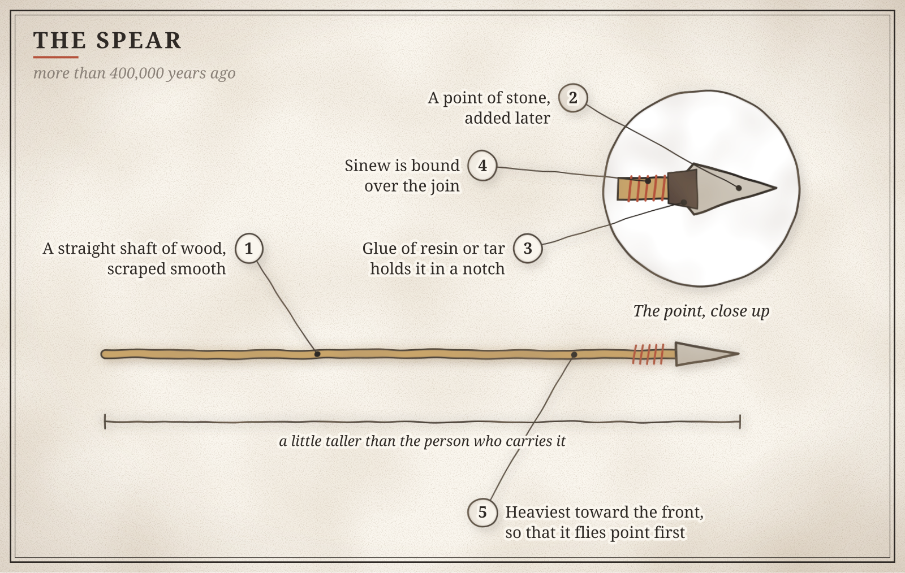
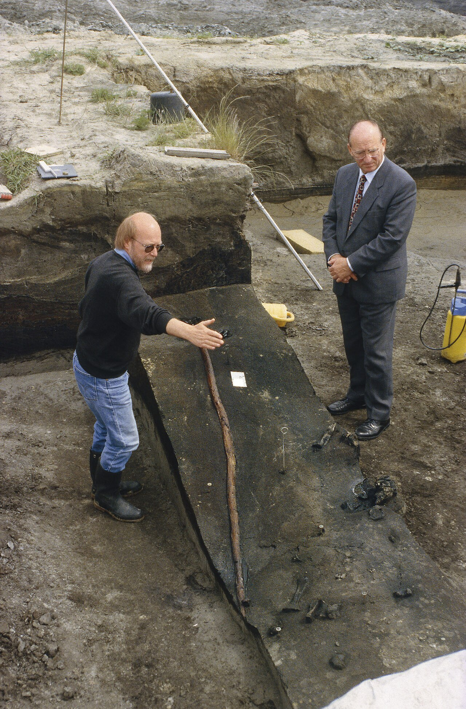

# The spear

| | |
|---|---|
| **First made** | More than 400,000 years ago |
| **Made of** | A wooden shaft, and later a point of stone held with glue |
| **What it does** | Kills from a few steps away |
| **Before it** | The club and the thrown stone |
| **After it** | The spear-thrower, the bow, the pike and the bayonet |

## Why it mattered

A spear puts a sharp point at the end of a long reach. A hunter with one can wound a large animal and stay clear of its horns and teeth.

It did the same between people, and that changed how bands were run. Among chimpanzees, a powerful male can terrorise the others, because none of them can stand up to him alone. A spear changes that. With a spear, the smallest man in the band can kill the largest, especially while the large man is asleep. Strength stopped being enough to make a tyrant safe. Among the hunters of northern Australia a century ago, most of the killing in war was done with spears, by raiders who surrounded a camp while it slept.

## The real thing

*A wooden throwing spear about 300,000 years old, as it was found at Schöningen in Germany. Photo: P. Pfarr, NLD, CC BY-SA 3.0 DE.*
