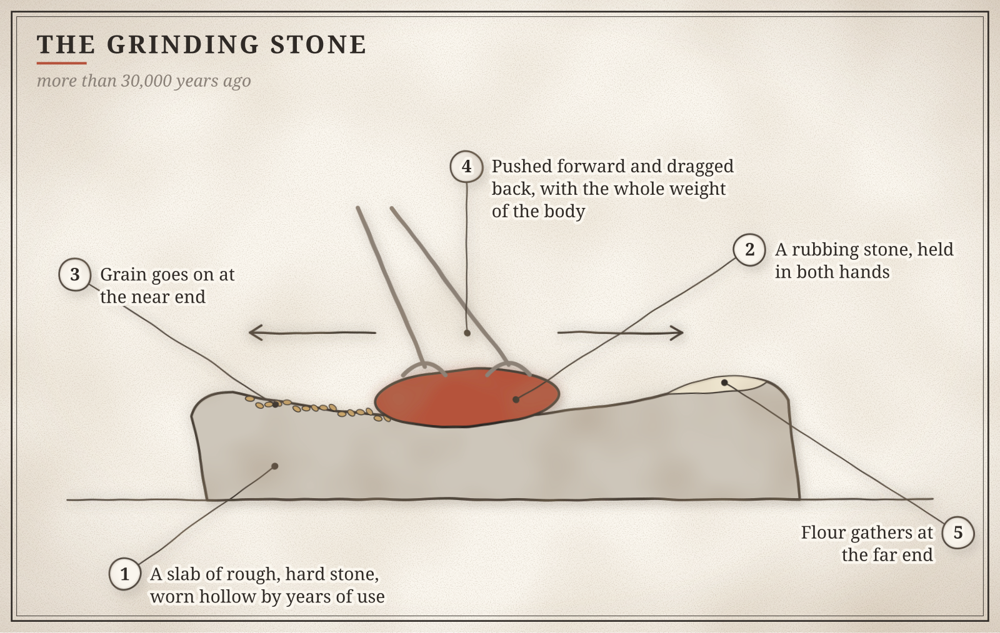
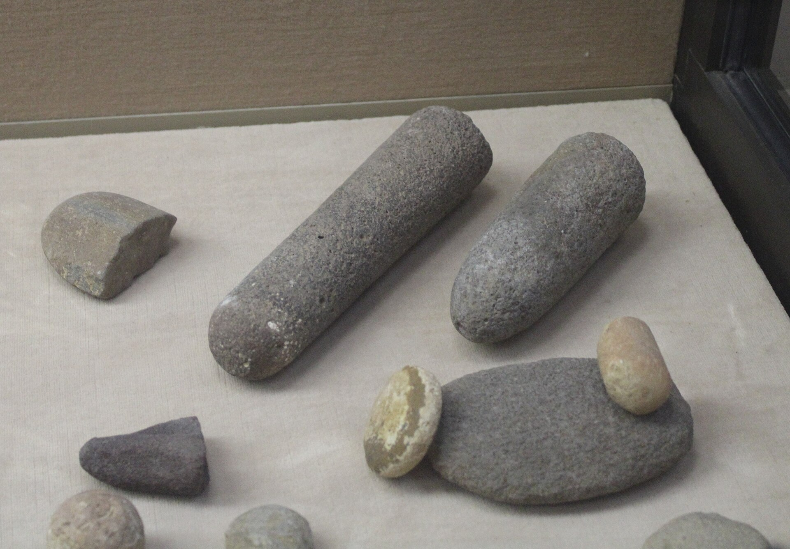

# The grinding stone

| | |
|---|---|
| **First made** | More than 30,000 years ago; used on wild cereals by 23,000 years ago |
| **Made of** | A slab of hard stone and a smaller rubbing stone |
| **What it does** | Turns hard seeds into flour |
| **Before it** | Chewing, pounding and soaking |
| **After it** | The turning millstone, the watermill and the windmill |

## Why it mattered

A grain of wheat is a hard seed in a tough coat. Ground into flour, it can be baked into bread. People were grinding wild grain twelve thousand years before anyone farmed.

Once people lived on grain, the grinding never stopped. To make flour, a woman knelt on the ground with her toes curled under her, and pushed a stone back and forth across a slab, throwing her whole weight forward and dragging it back. Feeding a family took hours of this every day, from adolescence. The skeletons from one early farming village on the Euphrates show what it cost them, in toes, knees and backs.

## The real thing

*Pestles, a grinding slab and hand stones about 14,000 years old, from a cave in Israel. Photo: Zunkir, CC BY-SA 4.0.*
