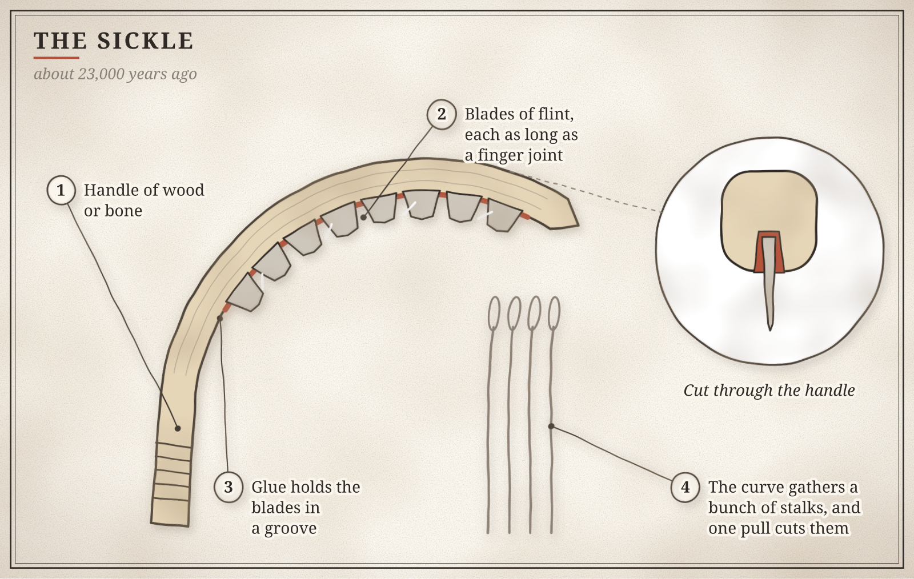
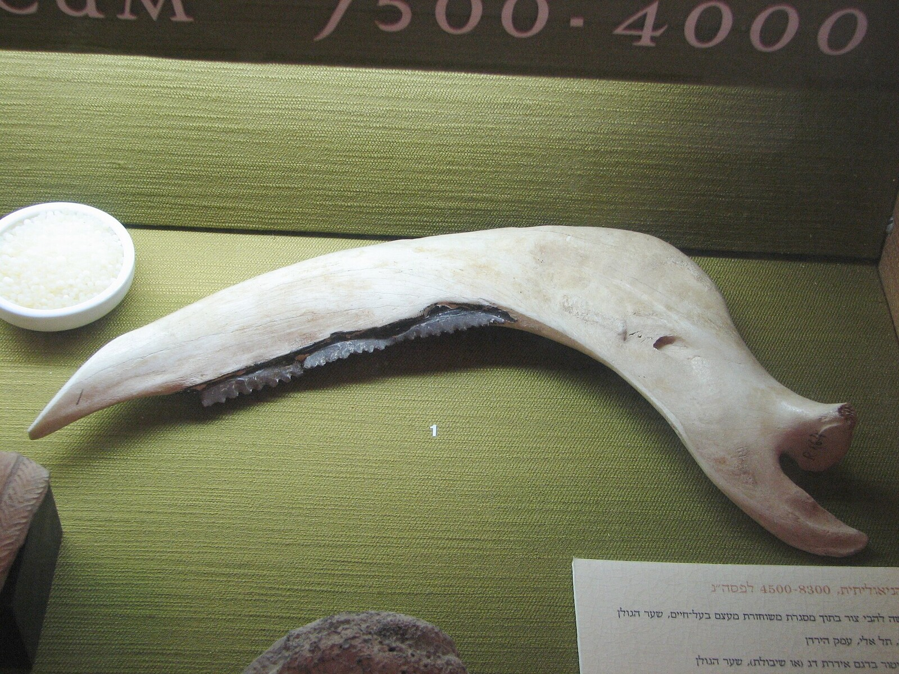

# The sickle

| | |
|---|---|
| **First made** | About 23,000 years ago, at the eastern end of the Mediterranean |
| **Made of** | Flint, wood or bone, and glue |
| **What it does** | Cuts a handful of stalks with one pull |
| **Before it** | Pulling plants up by the roots, or beating the seed into a basket |
| **After it** | The scythe, and in the end the combine harvester |

## Why it mattered

A sickle is worth making only for people who harvest grasses in bulk, and so the first sickles tell us when that began: thousands of years before anybody farmed.

It also did something that its makers never knew about. A sickle cuts the ears whose seed is still holding on. Seed that has already dropped stays behind in the field. So when people began to sow part of each harvest, they were sowing seed only from the plants that hold on. Over about three thousand years of cutting and sowing, that small difference turned wild wheat into a crop that does not drop its grain. Cutting grass also polishes flint to a shine, and that shine is how a harvesting blade is recognised today.

## The real thing

*A sickle from Sha'ar HaGolan, a village of early farmers in the Jordan valley. The flint blades are original and the bone handle has been restored. Photo: Hanay, CC BY-SA 3.0.*
