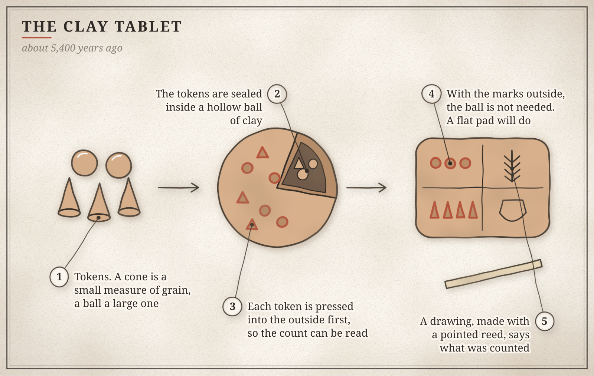
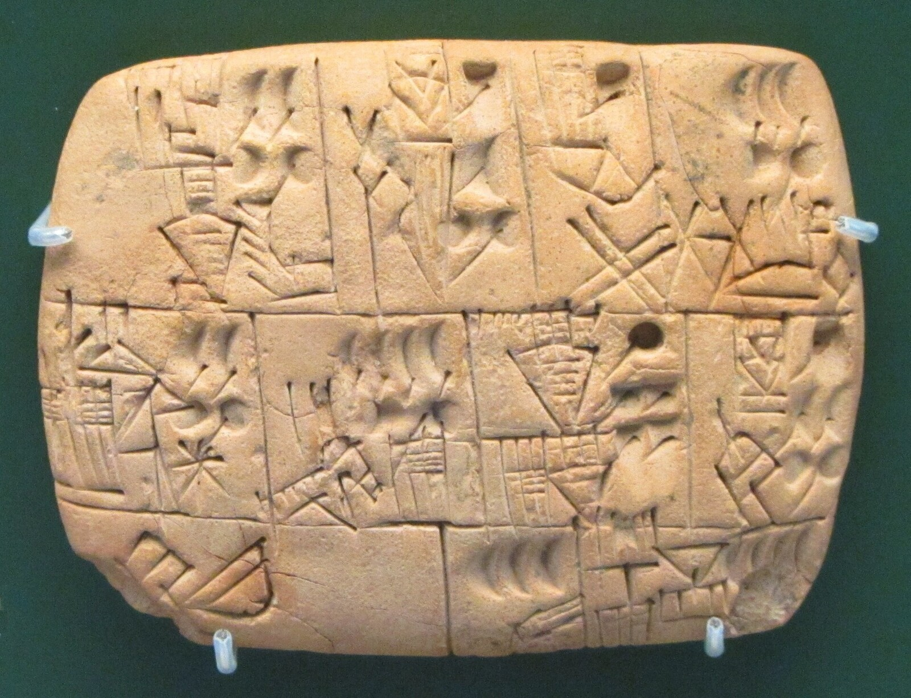

# The clay tablet

| | |
|---|---|
| **First made** | About 5,400 years ago, in the cities of southern Iraq |
| **Made of** | River clay, marked with a cut reed |
| **What it does** | Keeps a count where two people can both look at it |
| **Before it** | Memory, and loose clay tokens |
| **After it** | The ledger, the contract, the letter and the library |

## Why it mattered

Clay was the right material because the plain had nothing else. There was no stone and little wood, but there was mud on every riverbank. A lump the size of a palm could be shaped in a minute, written on while wet, and left in the sun to harden.

The reed shaped the writing too. Dragging a point through wet clay throws up ragged edges, so the clerks stopped drawing and began pressing, and the corner of a cut reed leaves a mark shaped like a wedge. A tablet also lasts. Buried in the ruins of a mud-brick city, it can lie there for five thousand years, and fire bakes it as hard as brick. That is why hundreds of thousands survive.

## The real thing

*A tablet from southern Iraq, about 5,100 years old, recording issues of beer. The round and curved dents are numbers, and the pointed jar is the sign for beer. Photo: BabelStone, CC BY-SA 3.0.*
