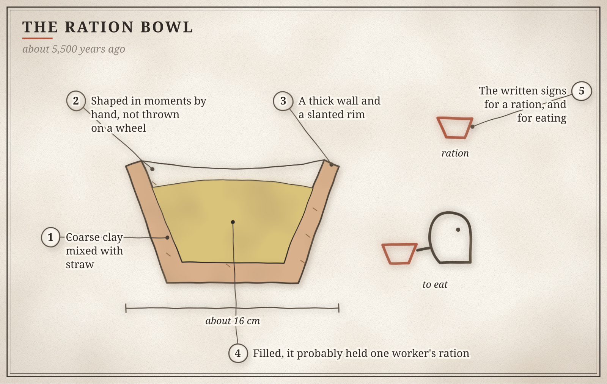
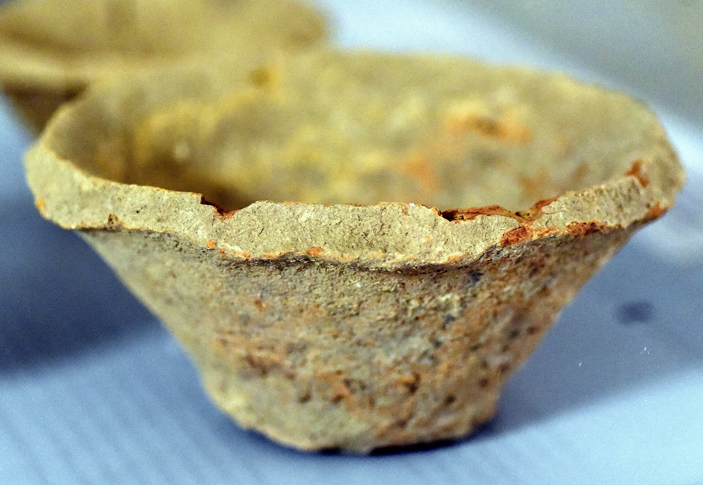

# The ration bowl

| | |
|---|---|
| **First made** | Nearly 6,000 years ago, on the plain of Iraq |
| **Made of** | Coarse clay mixed with straw |
| **What it does** | Probably served out food to workers, a bowl apiece |
| **Before it** | Sharing a harvest by eye |
| **After it** | The pay packet |

## Why it mattered

It is the commonest thing that comes out of the ground in the oldest cities of the Middle East, and it is an ugly one. The potters of the time could do far better. This bowl was shaped in a few moments without a wheel, baked, used and thrown away. At some sites, three out of every four pieces of broken pottery come from bowls of this one kind.

Each one probably held a worker's ration of food. When the people who used them began to write, their sign for a ration looked just like this bowl, and their sign for eating was the same sign set against a human head. A bowl of one kind, made by the thousand, means that somebody was feeding a great many workers out of a storehouse.

## The real thing

*One of the bowls, from Logardan in northern Iraq, between 6,000 and 5,100 years old. Photo: Osama Shukir Muhammed Amin, CC BY-SA 4.0.*
