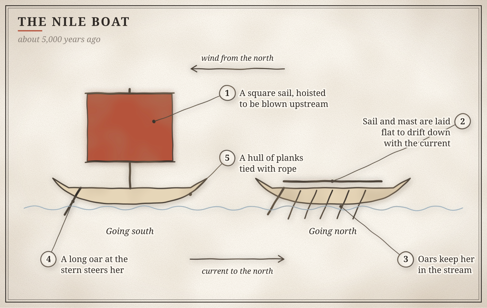
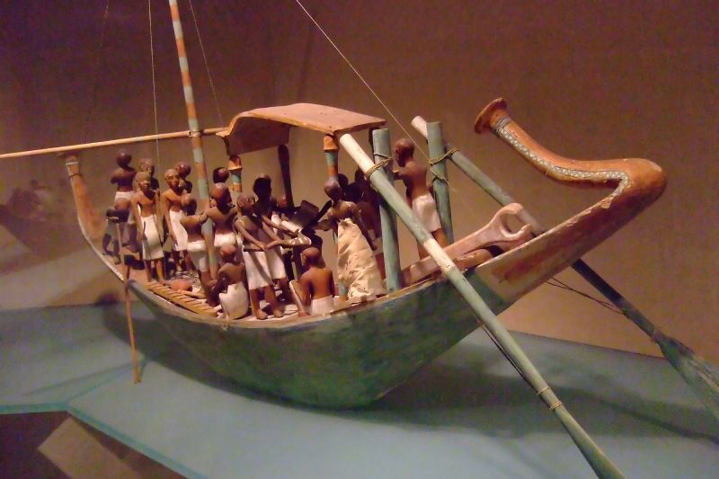

# The Nile boat

| | |
|---|---|
| **First made** | More than 5,000 years ago, in Egypt |
| **Made of** | Planks tied with rope, a mast and a square sail |
| **What it does** | Travels the length of Egypt in both directions |
| **Before it** | Rafts of bundled reeds, paddled |
| **After it** | The seagoing sailing ship |

## Why it mattered

The Nile's current flows north, towards the sea. The wind blows the other way, from the north, on most days of the year. A boat can therefore drift downstream with the current, and then put up a sail and be blown back upstream. In Egyptian picture-writing, the sign for travelling north was a boat with no sail, and the sign for travelling south was a boat under sail.

A ruler could hardly have designed a better road. Grain, stone, soldiers and tax collectors could reach any town in a valley a thousand kilometres long, and come back. That is a large part of why Egypt became one kingdom so early, and why it stayed one, with interruptions, for most of three thousand years.

## The real thing

*A model of a Nile sailing boat from an Egyptian tomb, about 4,000 years old. Its cloth sail has not survived. Photo: Mary Harrsch, CC BY 2.0.*
