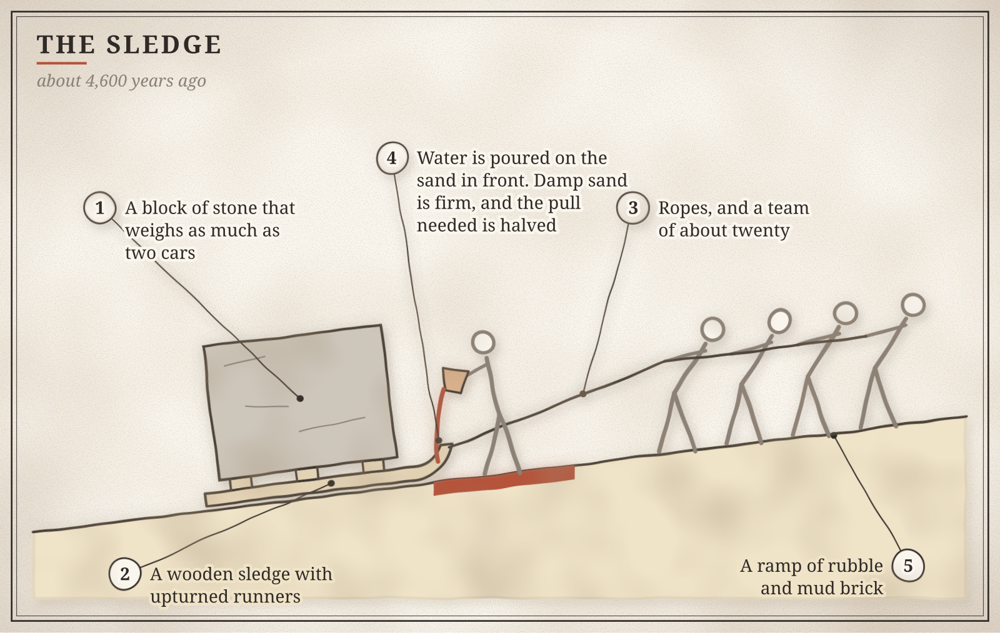
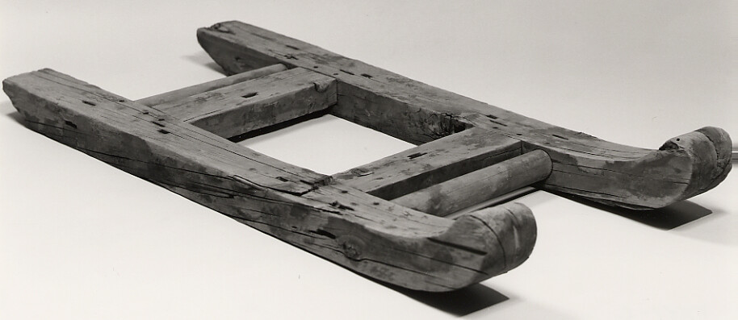

# The sledge

| | |
|---|---|
| **First made** | Long before the pyramids. In Egypt, in heavy use by about 4,600 years ago |
| **Made of** | Timber, rope of plant fibre, and water |
| **What it does** | Lets a team of people drag a load far too heavy to lift |
| **Before it** | Carrying, and levering a stone along end over end |
| **After it** | Rollers, and the greased slipway a ship is launched down |

## Why it mattered

The builders of the pyramids did not use carts. A wheel carrying a block of that weight sinks into sand and stops. A sledge spreads the same load along two long runners and stays on top.

The water is the clever part. An Egyptian tomb painting, made seven hundred years after the great pyramid, shows a huge statue on a sledge, with a man standing on the front pouring liquid onto the ground. Scholars used to take him for a priest performing a blessing. When physicists tried the experiment with a weighted sledge and a tray of sand, they found that he was doing a job, and that it cut the work in half.

## The real thing

*A sledge found beside a pyramid at Lisht in Egypt, about 3,900 years old. Photo: Metropolitan Museum of Art, CC0.*
