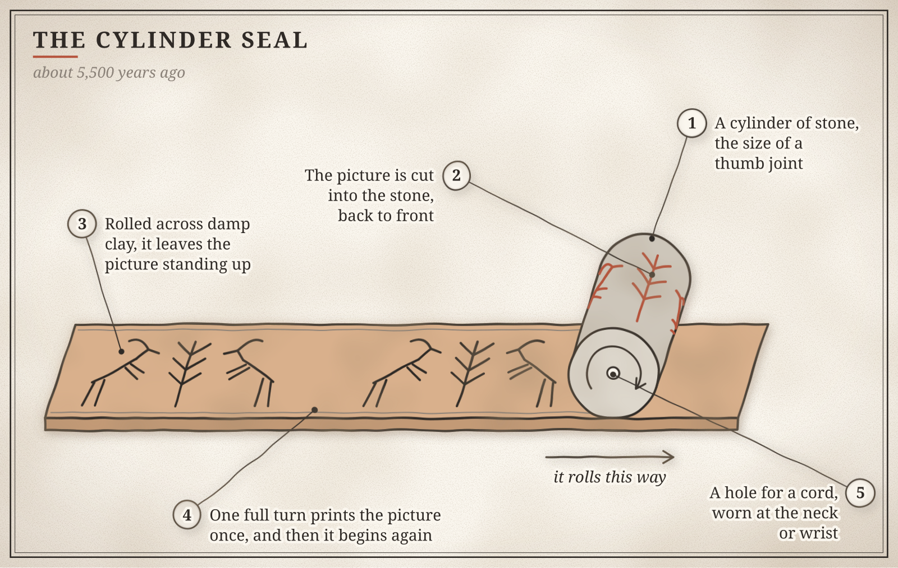
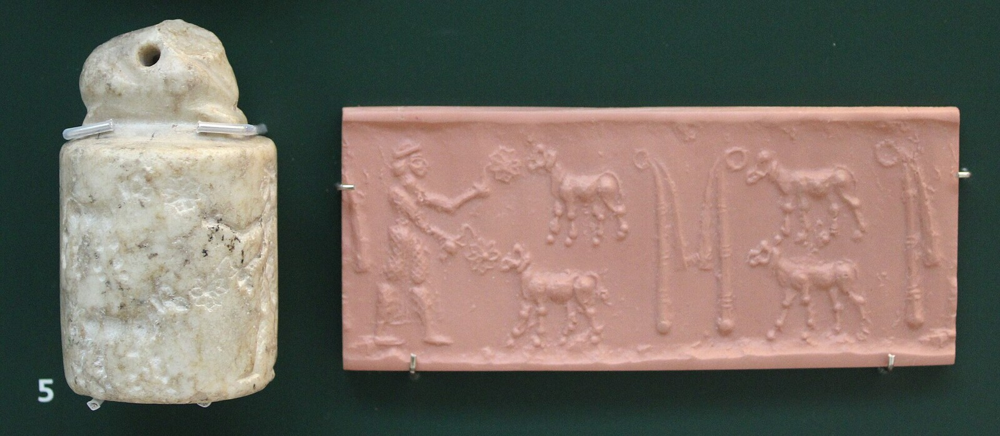

# The cylinder seal

| | |
|---|---|
| **First made** | About 5,500 years ago, in southern Iraq and south-west Iran |
| **Made of** | A small cylinder of stone |
| **What it does** | Prints its owner's mark on wet clay |
| **Before it** | The stamp seal, pressed down once |
| **After it** | The signet ring, the wax seal, the rubber stamp, the signature |

## Why it mattered

In a city of strangers, most people could not write. Even so, a storeroom had to be locked, a jar of oil had to reach its buyer unopened, and a clerk had to show which tablets were his.

The seal did all three. A lump of clay was pressed over the knot on a door or the stopper of a jar, and the seal was rolled across it. Nobody could get in without breaking the clay, and a sealing that had been broken or replaced showed at once to anyone who knew the owner's mark. Every seal was carved by hand, so no two were alike. It worked as a lock and a signature in one, at a time when hardly anyone could read.

## The real thing

*A seal from the time of the first cities in southern Iraq, about 5,200 years old, with a modern rolling of its picture: a man feeding a flock. Photo: Zunkir, CC BY-SA 4.0.*
