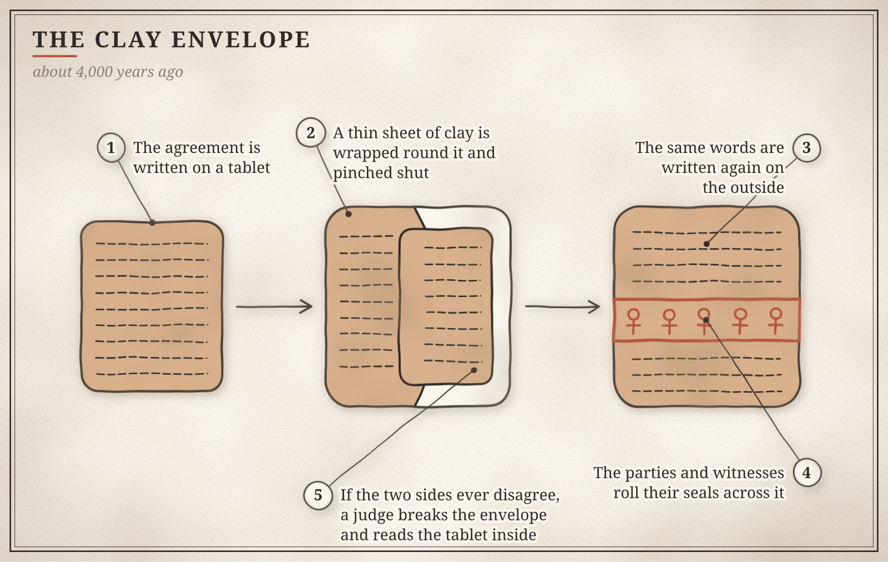
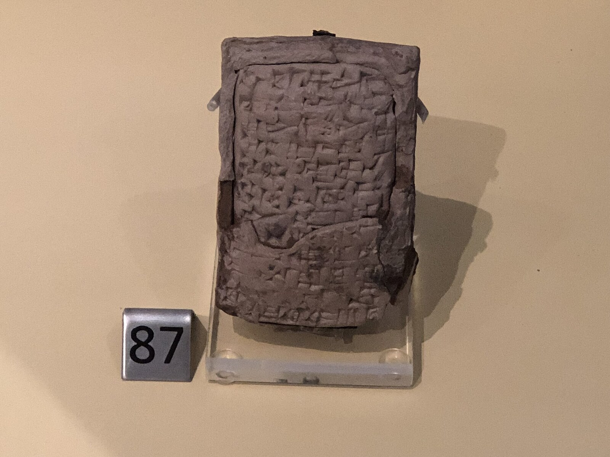

# The clay envelope

| | |
|---|---|
| **First made** | More than 4,000 years ago, on the plain of Iraq |
| **Made of** | A thin sheet of the same clay as the tablet inside |
| **What it does** | Locks a written agreement away where nobody can change it unseen |
| **Before it** | The hollow clay ball that held a merchant's counting tokens |
| **After it** | The sealed deed, the stamped envelope, the safety seal on a bottle |

## Why it mattered

Writing solved one problem of trust and created another. A written loan cannot be forgotten, but it can be altered, and a whole tablet can be swapped for a new one.

The envelope closed that gap with nothing but more clay. The outside could be read by anyone, and so it could be tampered with by anyone. The inside could not be reached without breaking the shell, and a broken shell cannot be mended without showing it. A cheat had to change both texts, and he could get at only one. As a result, a merchant could lend silver to a man he would not see again for a year, in a town six weeks away.

## The real thing

*A tablet from Babylonia, between 3,600 and 4,000 years old, still inside its envelope. The front of the envelope has broken away, and the tablet shows through. Photo: Maksim Sokolov, CC BY-SA 4.0.*
