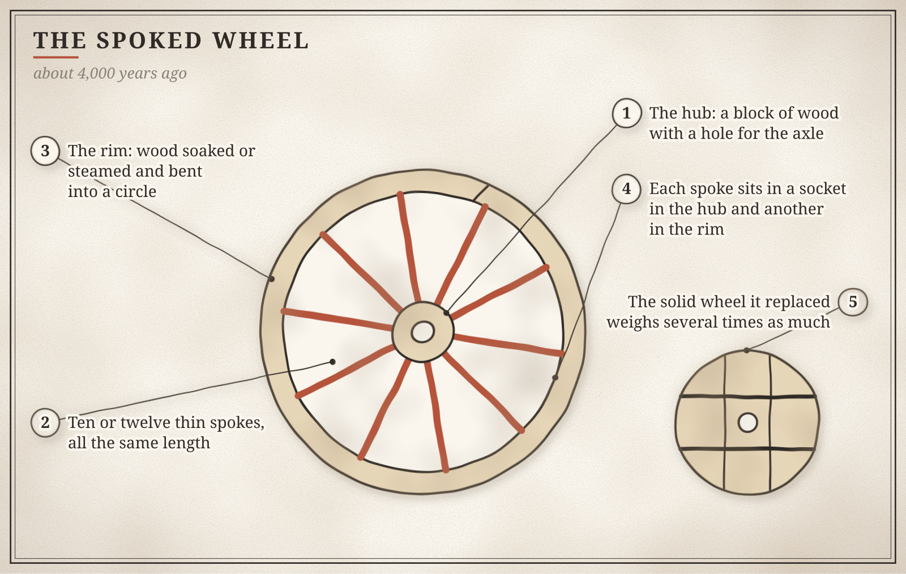
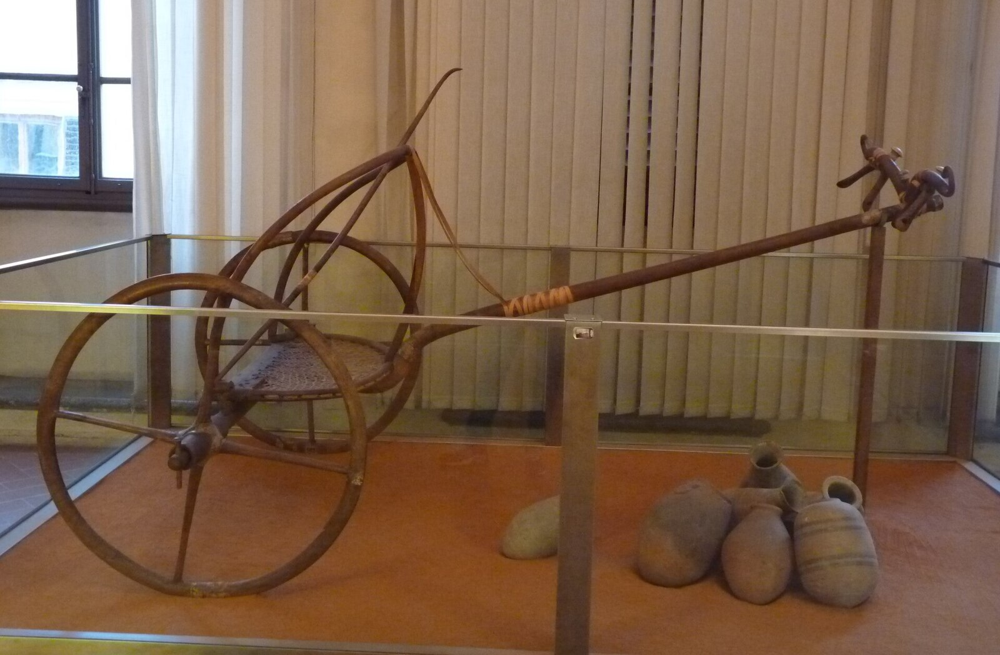

# The spoked wheel

| | |
|---|---|
| **First made** | About 4,000 years ago, on the grasslands east of the Ural mountains |
| **Made of** | Wood, with glue and rawhide at the joints |
| **What it does** | Carries a load on a wheel light enough for a horse to pull at a gallop |
| **Before it** | The solid wheel, built of thick planks |
| **After it** | The cartwheel, the carriage wheel, the bicycle wheel |

## Why it mattered

Most of a solid wheel does nothing. The wood between the hub and the rim mainly has to stop the two from moving closer together, and a few thin rods can do that as well as a thick plank can. A spoked wheel keeps the rods and throws the rest away.

What is left is a wheel that a child can lift, and that changes what can pull it. A horse's gift is speed, and a heavy wagon throws that gift away. Give a pair of horses two light wheels and a small platform, and they will pull two men at more than thirty kilometres an hour. The price was skill: bending timber without cracking it, and fitting two dozen joints so tightly that the wheel stays true.

## The real thing

*An Egyptian chariot about 3,400 years old, now in Florence. Its wheels have four spokes each, and the whole vehicle can be lifted by one person. Photo: Khruner, CC BY-SA 3.0.*
