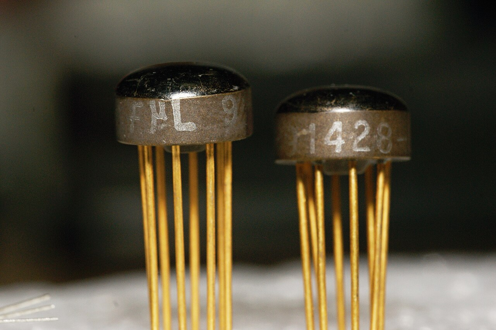

# The microchip

| | |
|---|---|
| **First made** | Texas Instruments, 1958; Fairchild, California, 1959 |
| **Made of** | Very pure silicon, with layers of glassy oxide and metal on top |
| **What it does** | Holds a whole circuit of tiny switches in one piece of silicon |
| **Before it** | Separate transistors, wired together by hand on a board |
| **After it** | Memory chips built in stacked layers, first sold by Samsung in 2013 |

![On the left, a black rectangular chip package seen from above with seven silver legs along each long side and a notch at one end. Its middle is cut away to show a small grey square of silicon marked with a fine grid, with silver strips running in towards it from the legs and short curved gold wires joining its edges to the strips. A tiny red square on the silicon is joined by dashed lines to a large magnified circle on the right, which shows one transistor cut across: a grey block of silicon with two blue patches near its surface, marked source and drain, a thin white layer on top between them, and a red block sitting on that layer, with grey metal contacts on each side and wires rising from all three. A dashed line and an arrow beneath the red block run from source to drain](microchip.png)

## Why it mattered

Jack Kilby's first chip, shown at Texas Instruments in September 1958, was a strip of germanium a centimetre long, with its parts joined by loose gold wires. It worked, but it was hard to make in quantity. At Fairchild, Robert Noyce used a colleague's flat method: every part lay in the silicon under a skin of glassy oxide, with the wiring printed on top, so the whole circuit was made at once. Kilby received a Nobel prize in 2000. Noyce had died in 1990, and the prize is not given to the dead.

The silicon is among the purest materials people make, at least 99.9999999 per cent. From 2011 the transistors stood up on edge, as thin fins with the gate wrapped round three sides.

## The real thing

*Two Fairchild Micrologic chips of a series designed in 1963, each sealed in a metal can. Photo: 155LA3, CC BY 4.0.*
