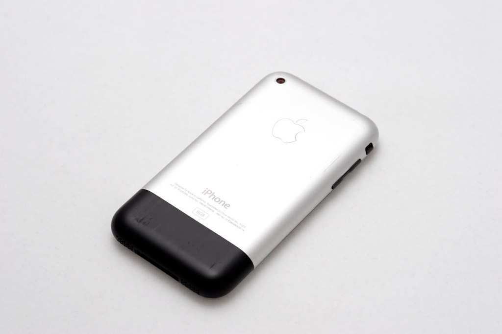

# The smartphone

| | |
|---|---|
| **First made** | IBM's Simon, 1994; Apple's iPhone of 2007 set the pattern |
| **Made of** | Glass, a metal frame, a lithium battery and silicon chips |
| **What it does** | Telephone, computer, camera and map in one glass slab |
| **Before it** | Phones with keys, such as the BlackBerry and its tiny keyboard |
| **After it** | Phones whose screens fold in half, from Samsung in 2019 |

![On the left, a dark phone seen from the front, with a small round camera at the top of its screen and five rows of coloured square icons. In the middle, the same phone with its back taken off: a grey metal frame with small gaps near each corner, a green circuit board across the top holding a large black chip and two round camera lenses, a pale lithium battery filling most of the rest, and a speaker slot at the bottom. On the right, a magnified circle shows the screen cut across: a fingertip resting on a layer of pale cover glass, below it a row of small red dots for the wires of the touch layer, with dashed lines curving up from them to the finger, and beneath that a dark display with red, green and blue dots](smartphone.png)

## Why it mattered

The phone that set the pattern had almost no buttons. Its whole face was glass, and a grid of transparent wires under it felt the small electric charge of a fingertip, following several fingers at once. A gloved finger does nothing, because the glove blocks that charge.

A year later two things made it far more than a telephone. In July 2008 Apple opened its App Store, where outside programmers could sell programs for the phone. In October the first phone running Google's Android went on sale, and any maker could use that software without paying for it. Cheap Android phones carried the design round the world. By 2025 about seven smartphones in ten ran it.

## The real thing

*The first iPhone, 2007, from behind: radio waves passed through its black plastic end, not the metal. Photo: Carl Berkeley, CC BY-SA 2.0.*
