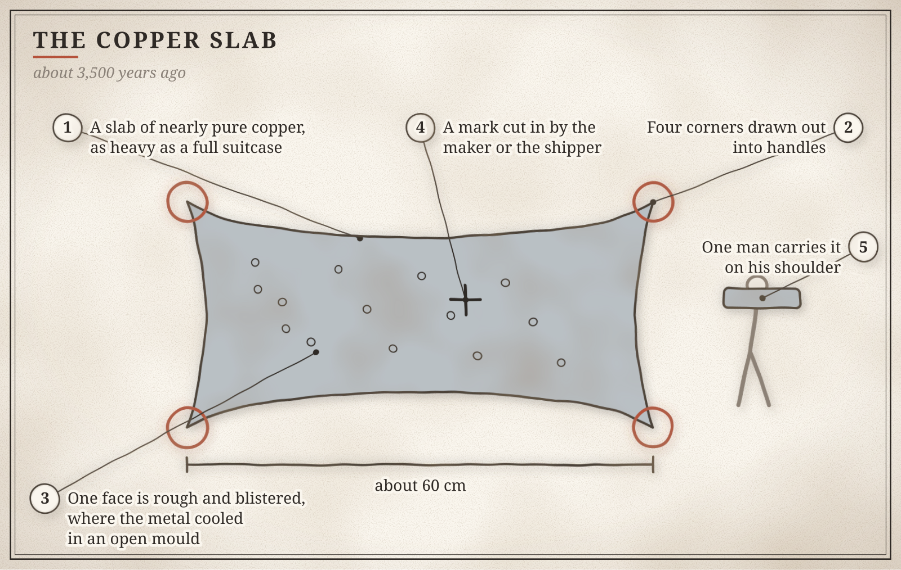
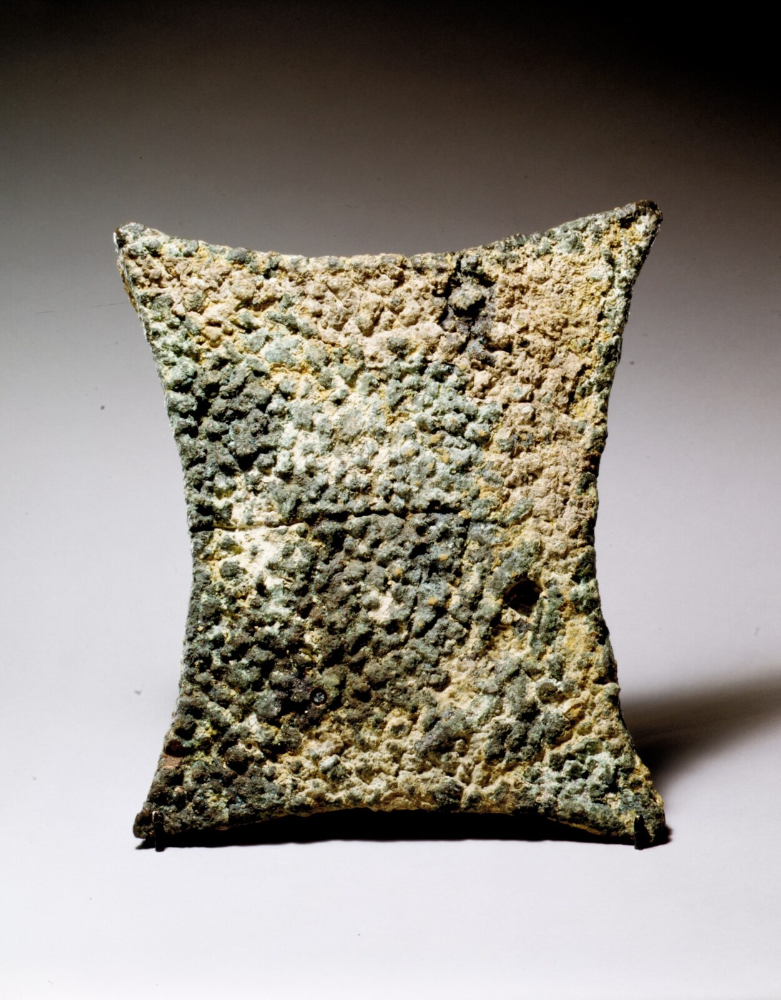

# The copper slab

| | |
|---|---|
| **First made** | About 3,500 years ago, around the eastern Mediterranean |
| **Made of** | Nearly pure copper, cast in an open mould |
| **What it does** | Turns metal into a cargo that can be carried, stacked and counted |
| **Before it** | Copper traded as small round cakes, lumps and scrap |
| **After it** | The ingot of every later metal, down to the gold bar |

## Why it mattered

Bronze tied the kingdoms of the eastern Mediterranean together, and this is the form in which the main ingredient travelled. A smelter in the hills of Cyprus turned ore into metal, and the slab is what he made of it, so that it could leave the island.

Everything about the shape serves the journey. It is about as much as one man can carry on his shoulder. It is flat, so that it lies in the bottom of a hull and keeps the ship steady. Slabs of this one pattern have been found from Sardinia to Syria, which means that smiths and merchants across the whole sea had agreed on what a load of copper looked like.

## The real thing

*A copper slab from Cyprus, about 3,400 years old, of an early pattern with short corners. Photo: Metropolitan Museum of Art, CC0.*
