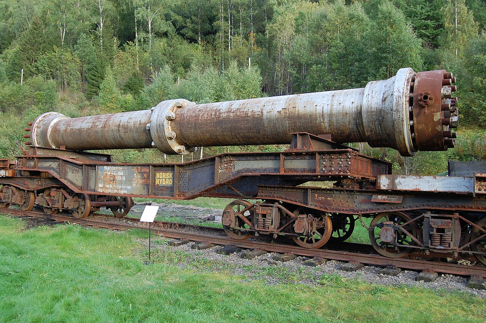

# The ammonia converter

| | |
|---|---|
| **First made** | Oppau, Germany, 1913, built by BASF from Fritz Haber's model of 1909 |
| **Made of** | A thick steel shell, a soft steel lining, iron catalyst inside |
| **What it does** | Joins nitrogen from the air to hydrogen, making ammonia |
| **Before it** | Electric arcs burning air, Notodden, Norway, 1905, on cheap water power |
| **After it** | Kellogg's single big converter fed by turbine compressors, Texas, mid-1960s |

![A loop of grey pipework on paper. At the bottom left, gas comes in through a pipe to a grey box with a fan wheel inside, and from it a pipe rises and runs right into the side of a tall upright cylinder with bolted flanges at top and bottom. The cylinder is drawn cut open: a thick grey wall dotted with small white holes, a pale lining inside it, and in the middle a tall red block speckled with dark grains, with arrows showing gas flowing down through it. From the bottom of the cylinder a pipe runs right to a pale blue box with curved coils inside, then up and across into a tank partly filled with pale blue liquid, which drains out at the bottom. From the top of the tank a long pipe climbs to the top of the picture and runs back left, with an arrow, to join the incoming gas](ammonia-converter.png)

## Why it mattered

Nitrogen gas is two atoms locked together, and the iron catalyst is what pries them apart. Each pass through the converter turns only about a seventh of the gas into ammonia, so the rest is cooled, stripped of its ammonia and sent round again until almost all of it is used. Finding the catalyst took BASF some 20,000 experiments.

The vessel was the harder problem. Hot hydrogen under pressure soaks into steel and makes it brittle, and the first tubes burst after about 80 hours. Carl Bosch's answer was a soft lining to hold the gas and a strong outer shell to hold the pressure, drilled with small holes. Today ammonia making uses one or two per cent of the world's energy.

## The real thing

*An ammonia converter, a thick steel tube, on a railway wagon of 1928 at Rjukan, Norway. Photo: David Aasen Sandved, CC BY-SA 3.0.*
