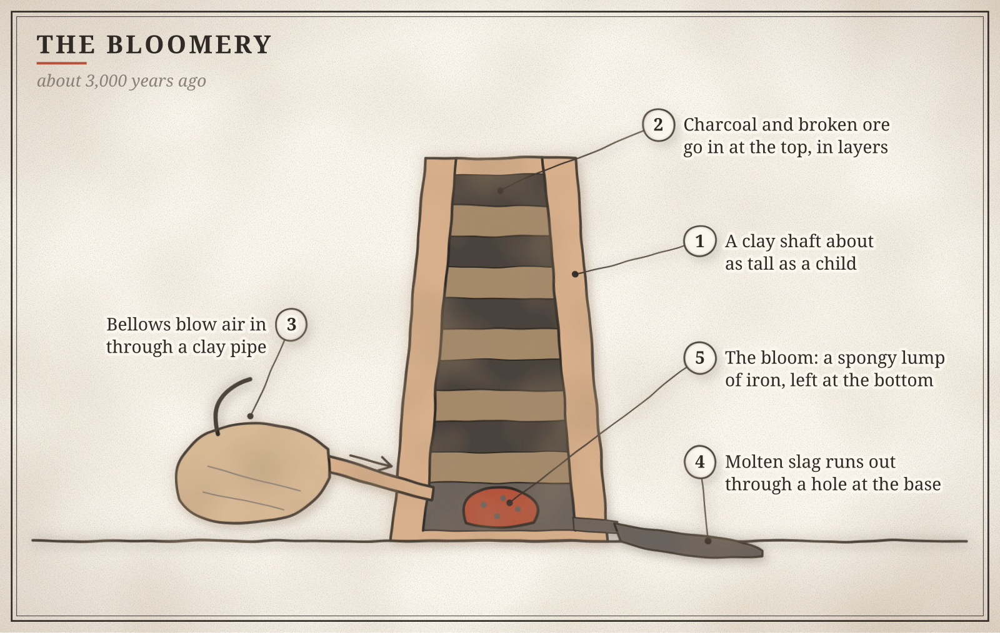
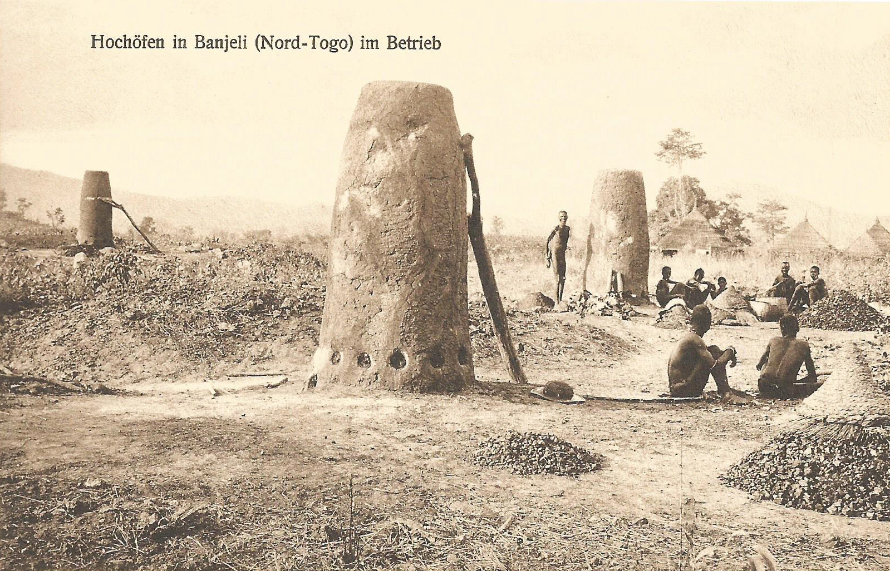

# The bloomery

| | |
|---|---|
| **First made** | More than 3,000 years ago, in the lands between Turkey and Iran |
| **Made of** | Clay, with bellows of animal skin |
| **What it does** | Turns iron ore into a lump of solid iron without melting it |
| **Before it** | Bronze, and a little iron from fallen meteorites |
| **After it** | The blast furnace, which turns out iron as a liquid |

## Why it mattered

A bloomery makes poor use of everything put into it. A day's work by several people, and a heap of charcoal several times as heavy as the metal, yields a few kilos of iron.

Its strength is that it needs nothing rare. Bronze needs tin, which lies in a few far-off places, and it depended on ships and caravans to bring the tin to the copper. Iron ore lies in most countries, and so do clay and trees. Anyone who knew the method could build a bloomery beside the ore, out of the ground it stood on. That is how iron became the metal of ordinary people. A king could control a tin route. He could not control every hillside with red stones in it.

## The real thing

*Clay iron furnaces at work at Banjeli in northern Togo, on a postcard from the years before 1914. They are taller than a man, and they draw their own air through the holes at the base without bellows. Photo: photographer unknown, public domain.*
