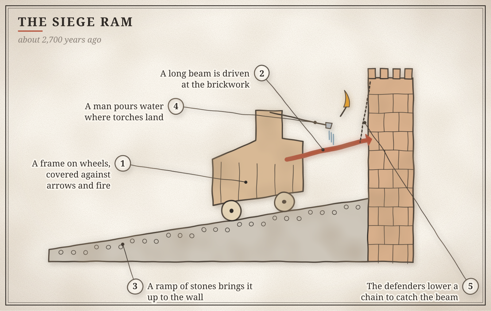
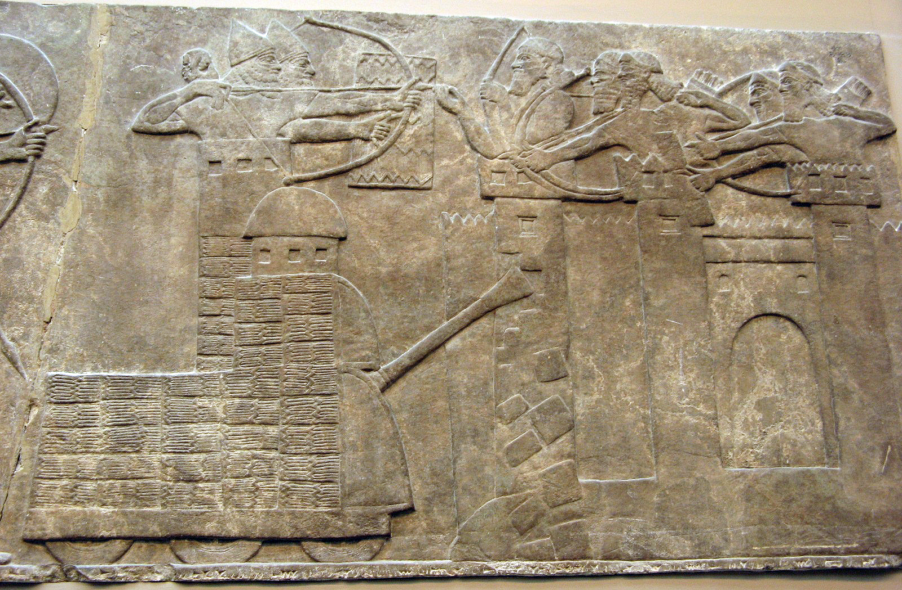

# The siege ram

| | |
|---|---|
| **First made** | Simple rams about 3,800 years ago; Assyria's wheeled ram by about 2,880 years ago |
| **Made of** | A timber frame on wheels, with a long beam |
| **What it does** | Breaks a hole in a city wall |
| **Before it** | Ladders, tunnels, and waiting for hunger |
| **After it** | The catapult and the cannon |

## Why it mattered

A wall of mud brick stops an army of spearmen. For a long time, the usual ways past one were to climb it, dig under it, or wait for the people inside to starve. A ram attacks the wall itself. The carvings of the siege of Lachish show the machines rolling up ramps with their beams against the brickwork, while the defenders throw down torches and an Assyrian soldier pours water over the front to keep it from catching fire.

Rams did not make sieges cheap. At Lachish the ramp alone took about three million stones. What they did was turn a wall into something that could be broken. A city could no longer rest its safety on brick alone, and its rulers had to weigh that against the price of opening the gates.

## The real thing

*A wheeled siege engine with its beam against a wall, carved for a palace at Nimrud about 2,880 years ago. Photo: Capillon, public domain.*
