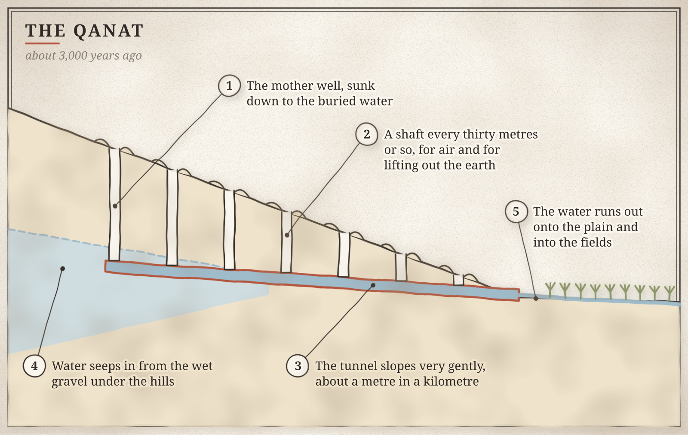
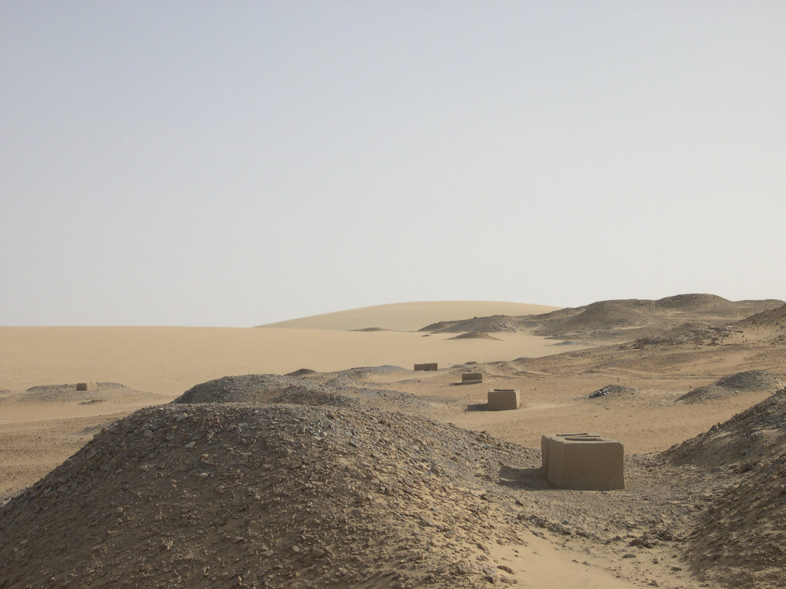

# The qanat

| | |
|---|---|
| **First made** | About 3,000 years ago, in Iran or eastern Arabia |
| **Made of** | Nothing but the ground: a tunnel and a row of shafts, dug by hand |
| **What it does** | Brings buried water out onto dry land without lifting it |
| **Before it** | Wells, and buckets hauled up on a rope |
| **After it** | The same thing, from Morocco to western China |

## Why it mattered

A well gives water only as fast as somebody can lift it. A qanat has no moving parts and needs no lifting. Once it is dug, the slope of the ground does the work, day and night, for as long as the tunnel is kept clear and the gravel under the hills stays wet. It also keeps its water in the cool and the dark until it reaches the fields.

What it costs is labour and nerve. The diggers worked by lamplight in a tunnel too low to stand in, under a roof that could fall, and they had to hold a slope that the eye cannot see. At Gonabad in eastern Iran the mother well is about 300 metres deep, which is the height of the Eiffel Tower.

## The real thing

*The line of a qanat at Ain Manawir in the western desert of Egypt, dug under Persian rule about 2,400 years ago. Each square block stands over a shaft. Photo: NYU Excavations at Amheida, Institute for the Study of the Ancient World, CC BY 2.0.*
