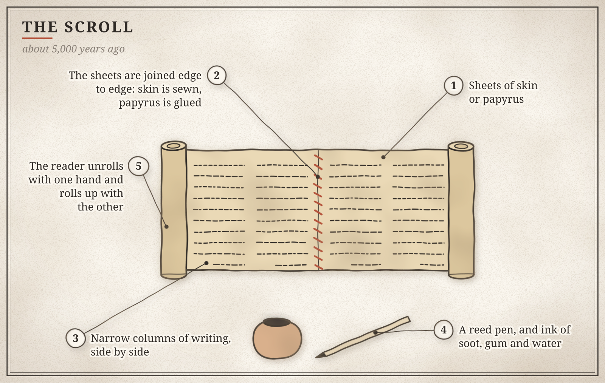
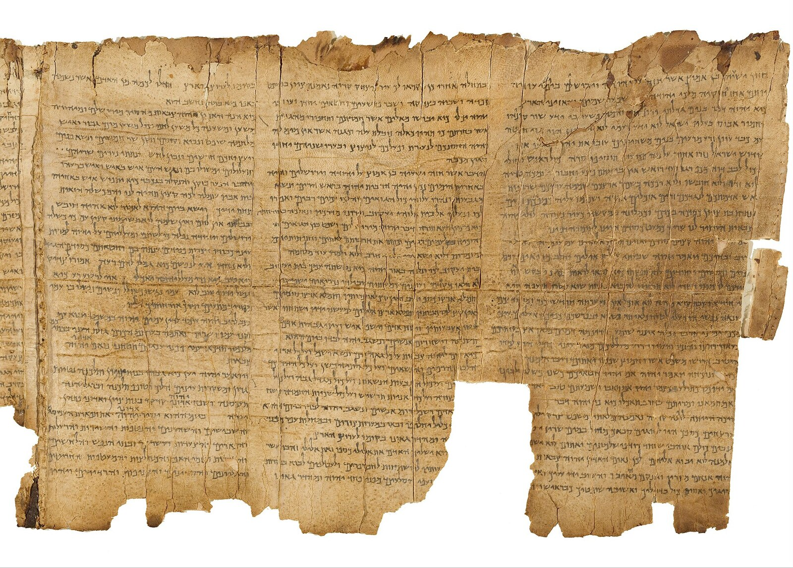

# The scroll

| | |
|---|---|
| **First made** | About 5,000 years ago, in Egypt |
| **Made of** | Sheets of papyrus or animal skin, joined into a strip |
| **What it does** | Holds a long text in something light enough to carry in one hand |
| **Before it** | Clay tablets, stone, and loose sheets |
| **After it** | The book with pages |

## Why it mattered

A clay tablet is about the size of a hand, and a long work filled a shelf of them. The story of Gilgamesh takes twelve. A scroll could hold a work of that length in a single roll that a reader could carry in one hand, and it could go into a bag and travel.

It also suited the alphabet. Twenty-odd letters, written quickly in ink, could set down a law, a history or a collection of songs. A people who kept such scrolls and copied them could carry their whole past with them wherever they went. The scroll had faults. It rotted in the damp, and to find a passage near the end, a reader had to wind through all that came before.

## The real thing

*A length of the Temple Scroll, found in a cave near the Dead Sea and about 2,000 years old. It is written in ink on very thin skin. Photo: Israel Museum, Google Art Project, public domain.*
