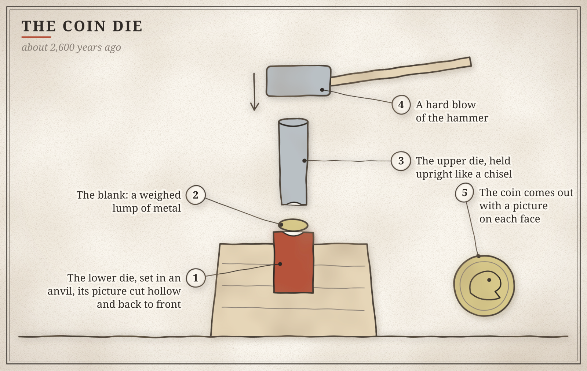
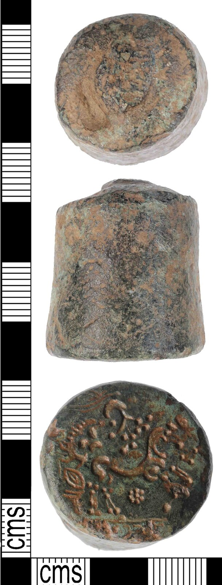

# The coin die

| | |
|---|---|
| **First made** | About 2,600 years ago, in western Turkey |
| **Made of** | Bronze or iron |
| **What it does** | Stamps one picture onto coin after coin |
| **Before it** | Lumps of metal, weighed at each payment |
| **After it** | The coin press |

## Why it mattered

A die is a way of making the same thing many times. An engraver cut a lion or an owl into the end of a bronze block, once. After that, two men with a hammer could put his work onto a coin every few seconds, and one lower die was good for more than ten thousand coins.

Each of those coins was a small promise from a king or a city, and the die made the promise hard to forge. Anybody with scales could match the weight of a coin. Matching the picture took an engraver as good as the mint's own.

## The real thing

*An upper die found in Kent, in England, about 2,100 years old and three centimetres tall, seen from three sides. Photo: Kent County Council, Portable Antiquities Scheme, CC BY 2.0.*
