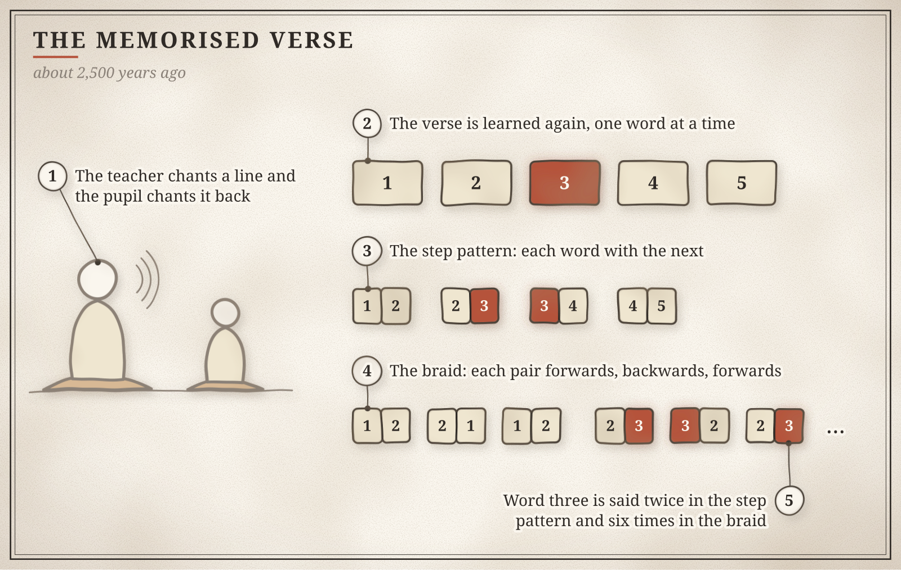

# The memorised verse

| | |
|---|---|
| **First made** | About 2,500 years ago, in northern India, with harder patterns added later |
| **Made of** | A trained memory, a teacher's voice and about twelve years of a boy's life |
| **What it does** | Carries a long text across the centuries by ear, with its words unchanged |
| **Before it** | Plain repetition, which drills in a mistake as firmly as the right word |
| **After it** | Nothing has replaced it. Its modern cousin is the check digit on a barcode |

## Why it mattered

A text that lives in memory usually drifts. Singers improve one line, forget another and patch the gap, and after a few generations nobody can say what the first version was. The priests who kept the hymns of the Rigveda wanted the opposite, because for them the force of a hymn lay in its exact sound.

The patterns let a memory be tested against itself. A verse learned in three or four arrangements is like a column of figures added up in three or four different orders. If the totals disagree, there is a mistake somewhere, and the place where they part company shows where to look.
