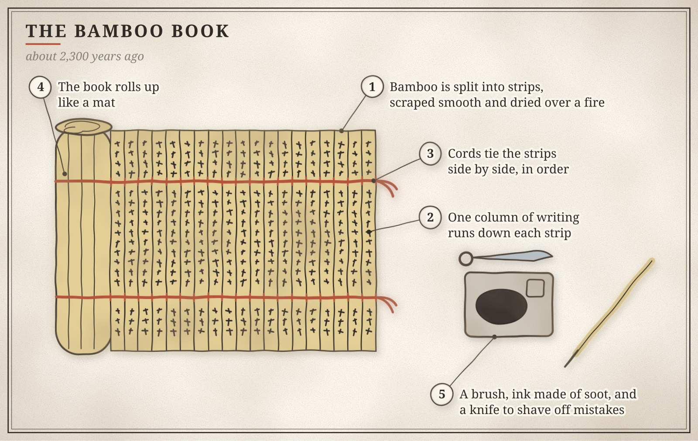
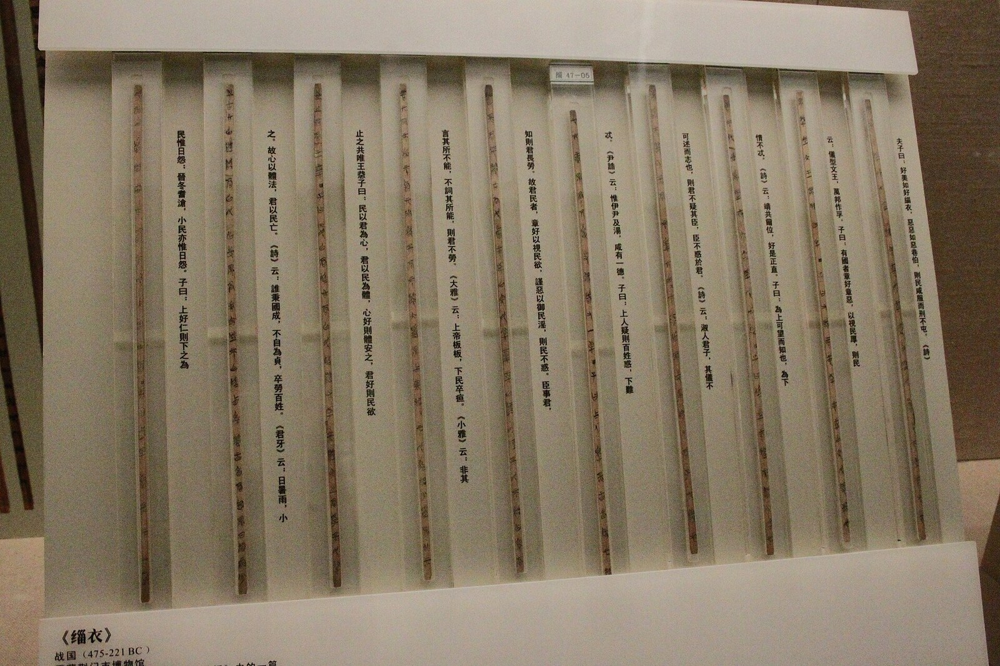

# The bamboo book

| | |
|---|---|
| **First made** | More than 3,000 years ago, in China |
| **Made of** | Strips of bamboo, cords of hemp or silk, and ink made of soot |
| **What it does** | Holds a long text on a cheap material that rolls up |
| **Before it** | Teaching learned by heart |
| **After it** | The paper scroll, and then the printed book |

## Why it mattered

Nearly everything a writer needed grew beside the road. A man with a saw and a knife could turn one stalk of bamboo into dozens of strips. Silk was also written on, and it was far lighter, but only the rich could afford it. With bamboo, a teacher's students could make their own copies of what he had said.

The price was weight, and the cords were the other weakness. When they rotted or snapped, a book became a heap of loose strips, and most strips carried no number. Scholars who study the bamboo books found in tombs still spend years putting the strips back in order.

## The real thing

*Bamboo strips between 2,500 and 2,200 years old, in the Hubei Provincial Museum. Photo: Gary Todd, CC0.*
