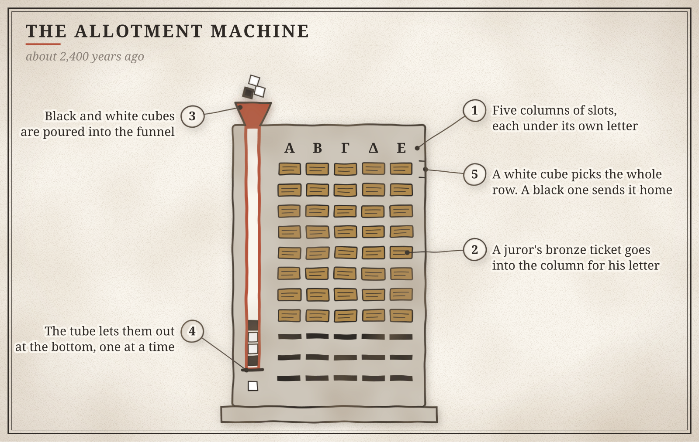
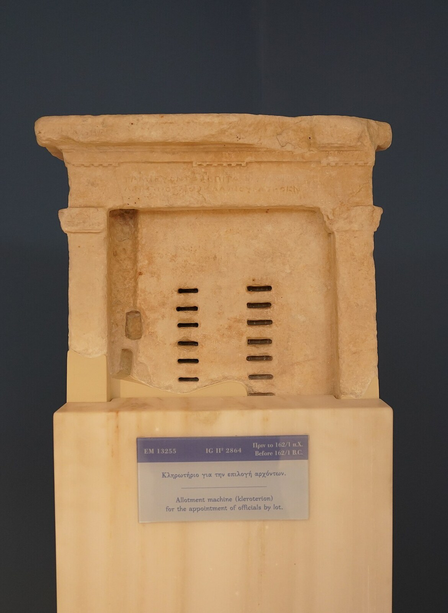

# The allotment machine

| | |
|---|---|
| **First made** | About 2,400 years ago, in Athens |
| **Made of** | A slotted slab of stone, a tube, and black and white cubes |
| **What it does** | Picks the day's jurors by chance, in public |
| **Before it** | Fixed panels of jurors, whose members were known in advance |
| **After it** | The jury summons, and the lottery drum |

## Why it mattered

A jury is easy to buy when the buyer knows who will sit on it. The machine took that knowledge away. Until the cubes dropped, nobody in Athens could say who would be a juror that day, and that included the officials who ran the courts.

The Athenians also saw that a draw is only as honest as the hands that carry it out. For that reason the man who pushed the tickets into the slots was himself chosen by lot, so that the same person could not always handle them and arrange them to suit a friend. Everything was done in the open, in front of the men whose names were on the stone.

## The real thing

*A small machine with two columns of slots, about 2,200 years old, in Athens. The groove on the left held the tube. Photo: TimeTravelRome, CC BY 2.0.*
