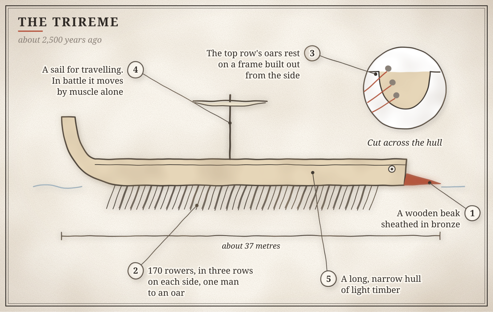
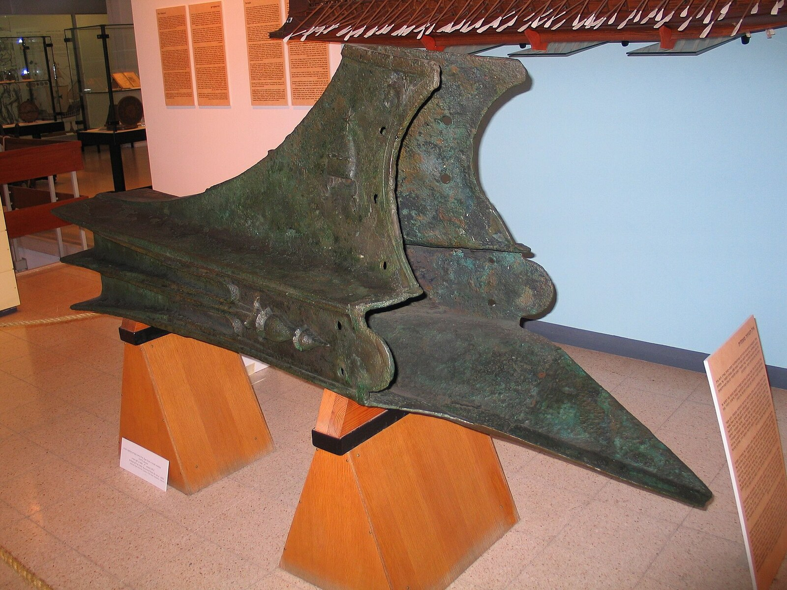

# The trireme

| | |
|---|---|
| **First made** | About 2,700 years ago, in Greece or Phoenicia |
| **Made of** | Light timber, with a beak sheathed in bronze |
| **What it does** | Turns 170 rowers into a single weapon |
| **Before it** | Warships with one or two rows of oars |
| **After it** | Larger galleys, with more men at the oars |

## Why it mattered

A trireme stripped for battle carried little except its rowers. The ship itself was the weapon. Its crew rowed it at an enemy ship and drove the beak into the planks, and in a sprint it moved at the pace of a good runner. That worked only if all hundred and seventy men pulled as one, which took months of practice.

A man needed money to stand in the line of armoured soldiers, since he had to buy the armour himself. A rower had nothing to buy. The fleet of Athens took more than thirty thousand men to pull it, more than twice as many as the armoured soldiers it could put in the field, and so the safety of the city came to rest on its poorer citizens. They took their share of the power in return.

## The real thing

*A bronze ram from a warship, found in the sea off Israel and about 2,150 years old. It comes from a larger ship than a trireme. Photo: Bukvoed, CC BY 3.0.*
