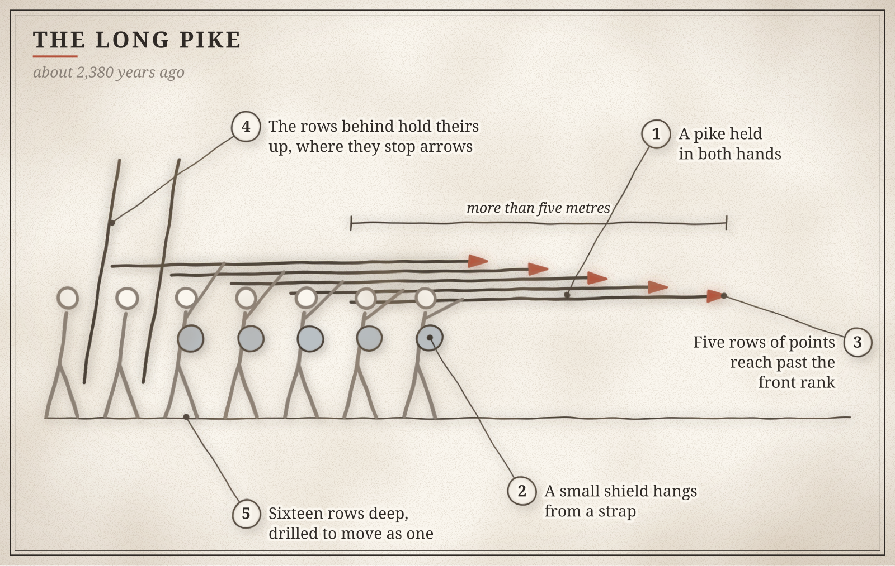
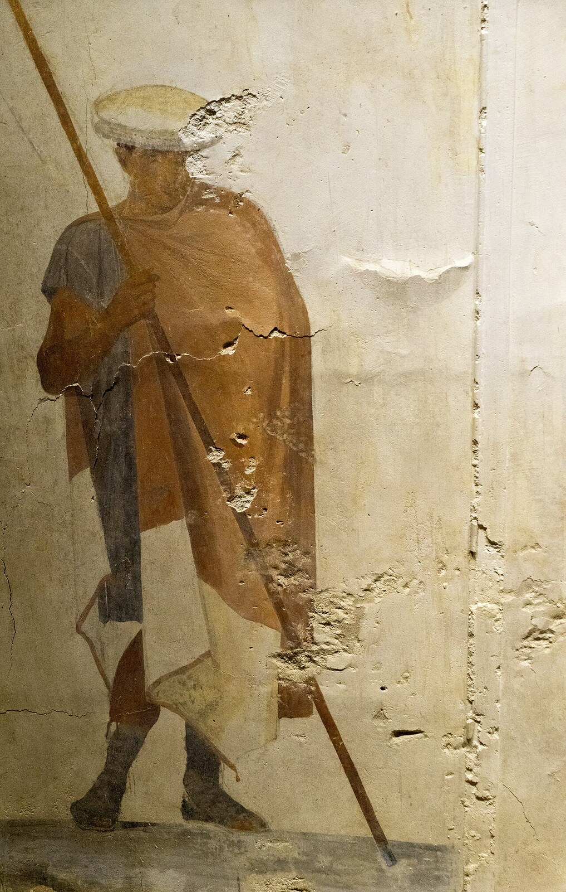

# The long pike

| | |
|---|---|
| **First made** | About 2,380 years ago, in Macedon |
| **Made of** | A long wooden shaft with an iron point and an iron butt |
| **What it does** | Puts five rows of spear points ahead of the front rank |
| **Before it** | The spear a little taller than a man |
| **After it** | The pike blocks of later European armies |

## Why it mattered

A Greek spearman carried a spear a little taller than himself and a large round shield. The Macedonian pike was more than five metres long and took both hands, so the shield shrank and hung from a strap. In a block sixteen rows deep, the points of the first five rows all stuck out beyond the front rank. An enemy with an ordinary spear had to get past five spearheads before he could touch anyone.

A block like that is hard to break from the front and slow to turn. It worked because Philip paired it with heavy cavalry. The pikes held the enemy in place, like an anvil, and the cavalry struck like a hammer. Philip could field such a block because he paid his men to drill all year.

## The real thing

*A Macedonian guard with his pike, painted on a tomb in northern Greece about 2,300 years ago. Photo: Egisto Sani, CC BY-SA 2.0.*
