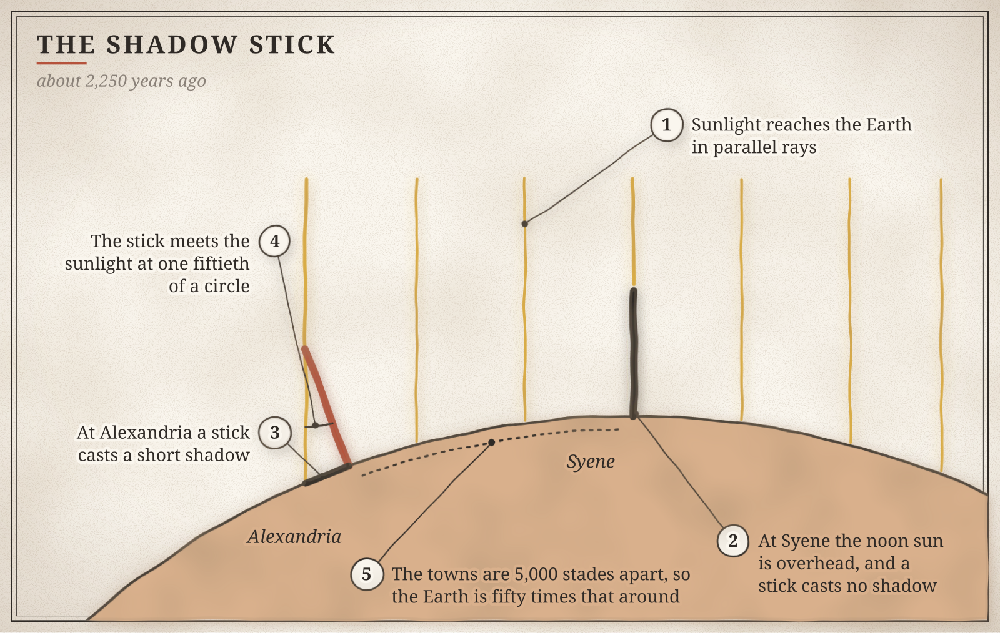
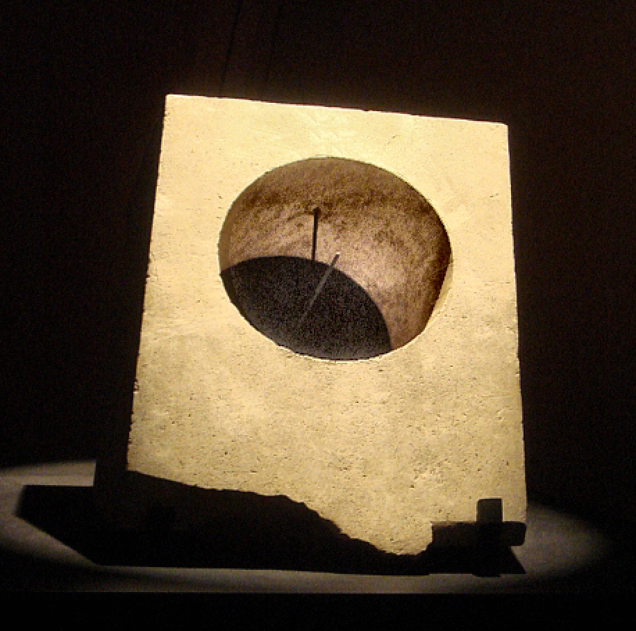

# The shadow stick

| | |
|---|---|
| **First made** | More than 3,500 years ago, in Egypt and Babylon |
| **Made of** | A straight rod of wood, stone or bronze, set exactly upright |
| **What it does** | Turns the sun's height into a length on the ground |
| **Before it** | Judging the hour and the season by eye |
| **After it** | The sundial, and the first measurement of the Earth |

## Why it mattered

An upright stick is about the cheapest scientific instrument there is, and for a long time it was the best. Its shadow is shortest at noon, and so it marks the middle of the day. The Greeks called the stick a gnomon, a word that means "one who knows".

Eratosthenes added a single idea. The same stick gives different answers in different places, and the difference shows how far the Earth has curved between them. With that, the stick became a tool for measuring something that nobody could pace out. Nobody had to leave Egypt to do it. The first ship to sail right round the Earth came home about 1,760 years later.

## The real thing

*A Greek sundial about 2,200 years old, from the Greek city on the Oxus in Afghanistan. Photo: World Imaging, CC BY-SA 3.0.*
