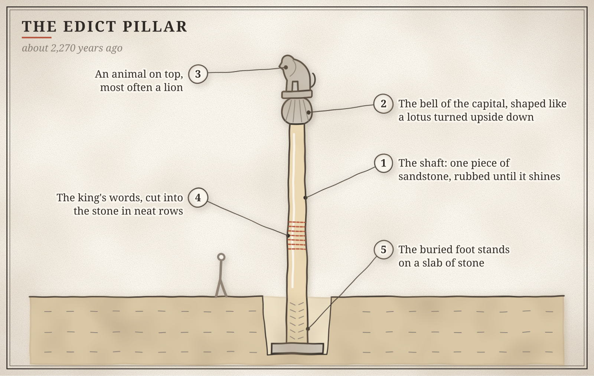
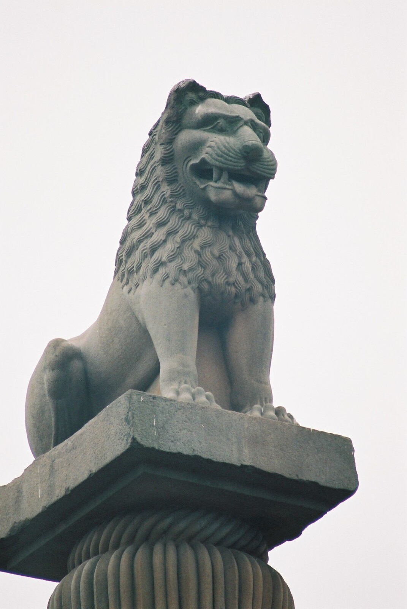

# The edict pillar

| | |
|---|---|
| **First made** | About 2,270 years ago, in northern India |
| **Made of** | Sandstone, in two blocks joined by a copper bolt |
| **What it does** | Stands a king's words in the open, where they will outlast him |
| **Before it** | Orders cut into boulders and cliffs, wherever the rock lay |
| **After it** | The inscribed columns of later Indian kings, and the emblem of India |

## Why it mattered

A boulder stays where nature left it, and a king who writes on boulders must take his words to the rock. A pillar can go exactly where he wants it. Ashoka set pillars up at the Buddha's birthplace and at the spot where the Buddha first taught.

In addition, the pillar said something before anybody read a word of it. Few passers-by could read. All of them could see a stone as heavy as a loaded lorry, often brought from a quarry hundreds of kilometres away, and polished like a jewel. A king who could do that plainly had orders that reached a long way.

## The real thing

*The lion on the pillar at Vaishali in northern India, still in place. This pillar carries no inscription. Photo: Hideyuki Kamon, CC BY-SA 2.0.*
