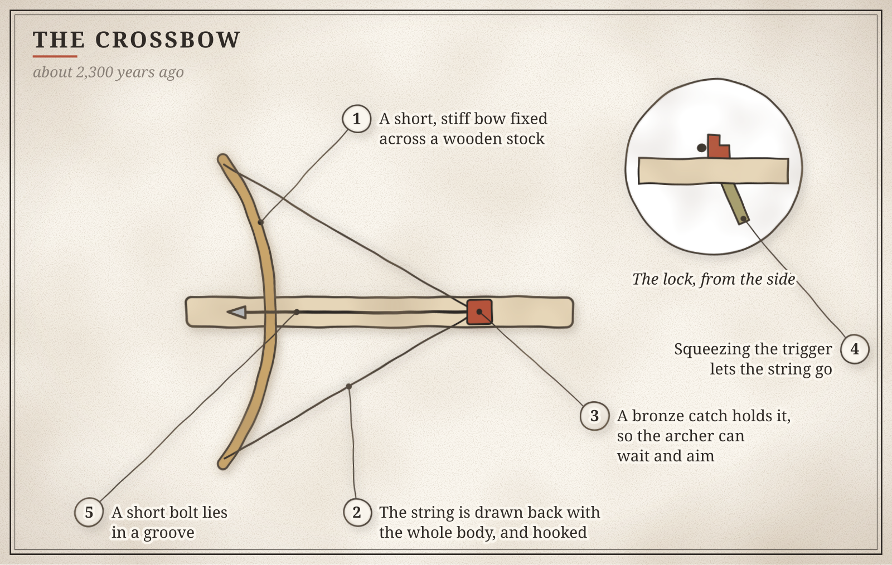
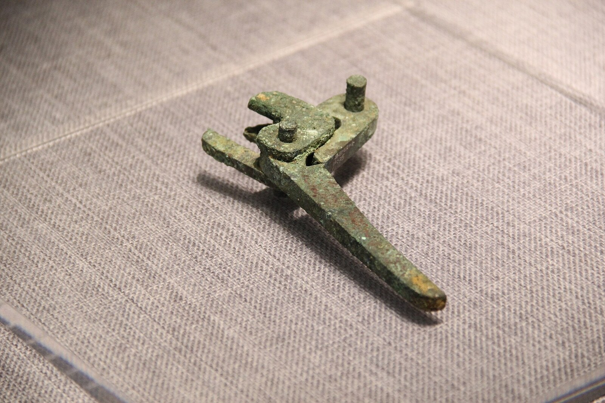

# The crossbow

| | |
|---|---|
| **First made** | About 2,500 years ago, in China |
| **Made of** | A wooden stock, a short bow, and a bronze lock |
| **What it does** | Holds a drawn bow ready, so the archer need not |
| **Before it** | The bow held drawn by the archer's own arm |
| **After it** | The crossbows of Europe, and the trigger of early guns |

## Why it mattered

An archer has to hold the full pull of his bow in his arm while he aims, and learning to do that well takes years. A crossbow separates the two jobs. The archer draws the string with his whole body and hooks it on a bronze catch. After that, the weapon holds itself. He can wait, aim along the stock, and let go by squeezing a trigger.

A farmer could learn to aim one far sooner than he could master a bow. That mattered in a China where wars were no longer an affair of noblemen in chariots, and each state filled its ranks with farmers by the tens of thousands. The clay soldiers buried beside the First Emperor carried real crossbows, with bronze triggers.

## The real thing

*A bronze crossbow lock from the time of the warring kingdoms, in the Hebei Museum. Photo: Gary Todd, CC0.*
