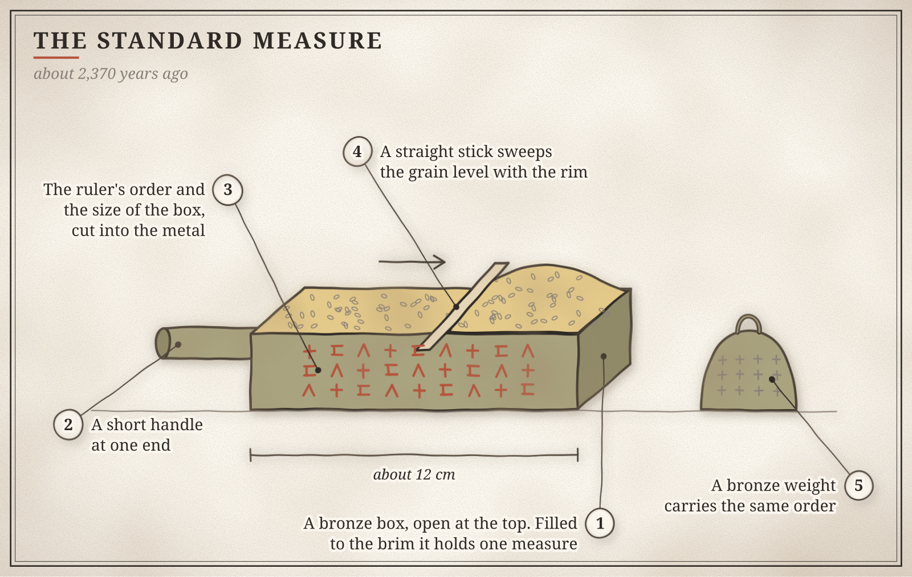
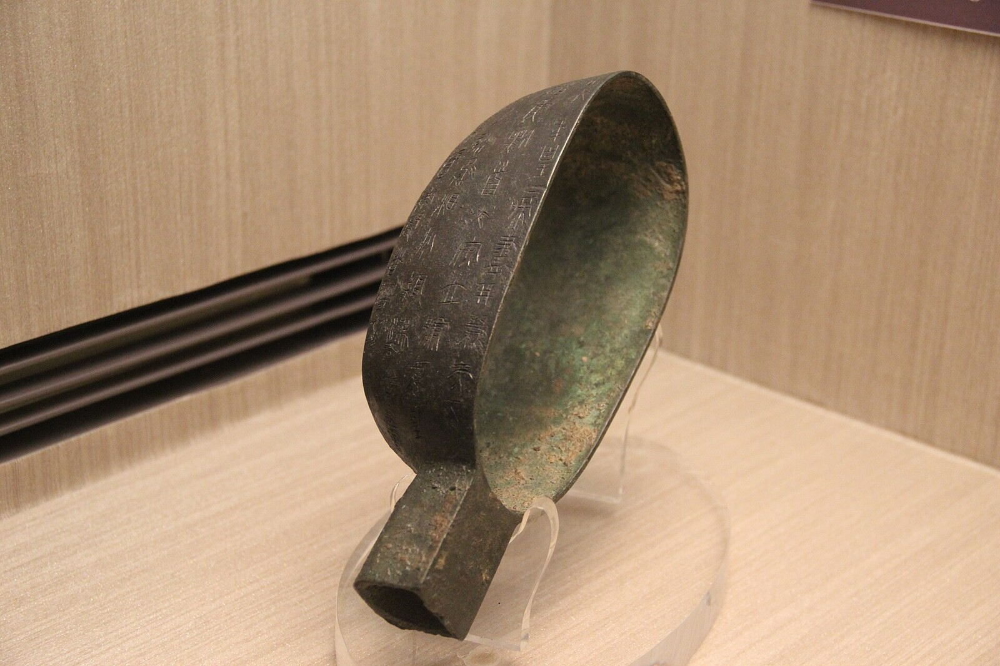

# The standard measure

| | |
|---|---|
| **First made** | This one about 2,370 years ago, in the kingdom of Qin in north-west China |
| **Made of** | Bronze for the masters, and wood or fired clay for everyday copies |
| **What it does** | Fixes how much grain counts as one measure, so that it is the same in every county |
| **Before it** | Each kingdom had measures of its own size |
| **After it** | The official measures of later Chinese dynasties, and the inspector's seal on a petrol pump |

## Why it mattered

A farmer in Qin paid his tax in grain, and an official measured it out. If the official's scoop was a little too large, the farmer was robbed. If it was a little too small, the state was.

Other kingdoms had official measures too. What Qin added was a box that states its own size, and then an empire in which every box was the same. As a result, numbers written down in one place meant the same thing in another. A granary a thousand kilometres from the capital could report how many measures it held, and a clerk at the capital could add that figure to the others and believe the total.

## The real thing

*A bronze measure of the Qin empire, about 2,240 years old, with the emperor's order cut into its side. This one is oval. Photo: Gary Todd, CC0.*
