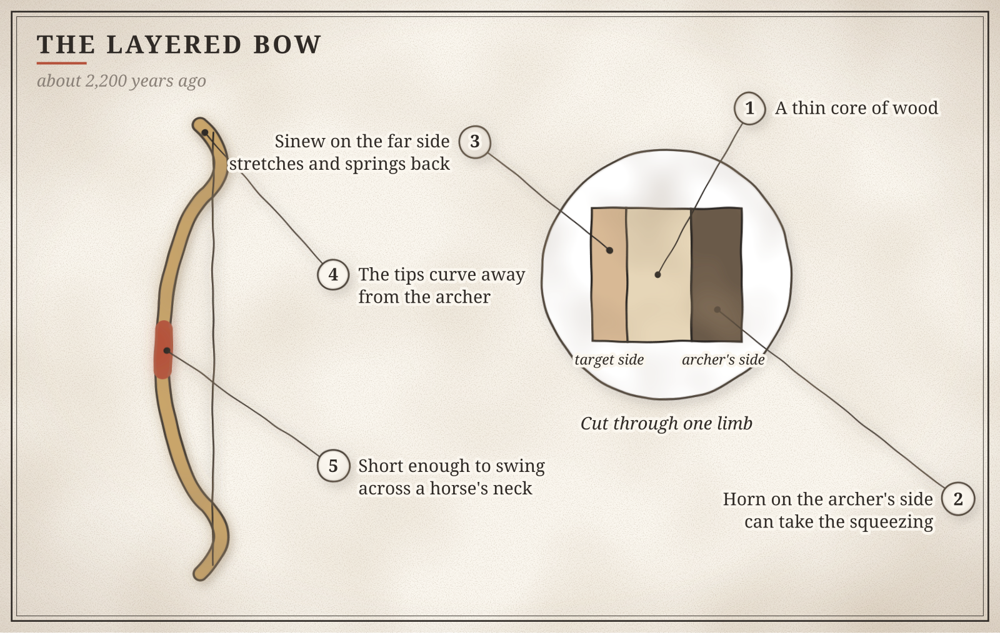
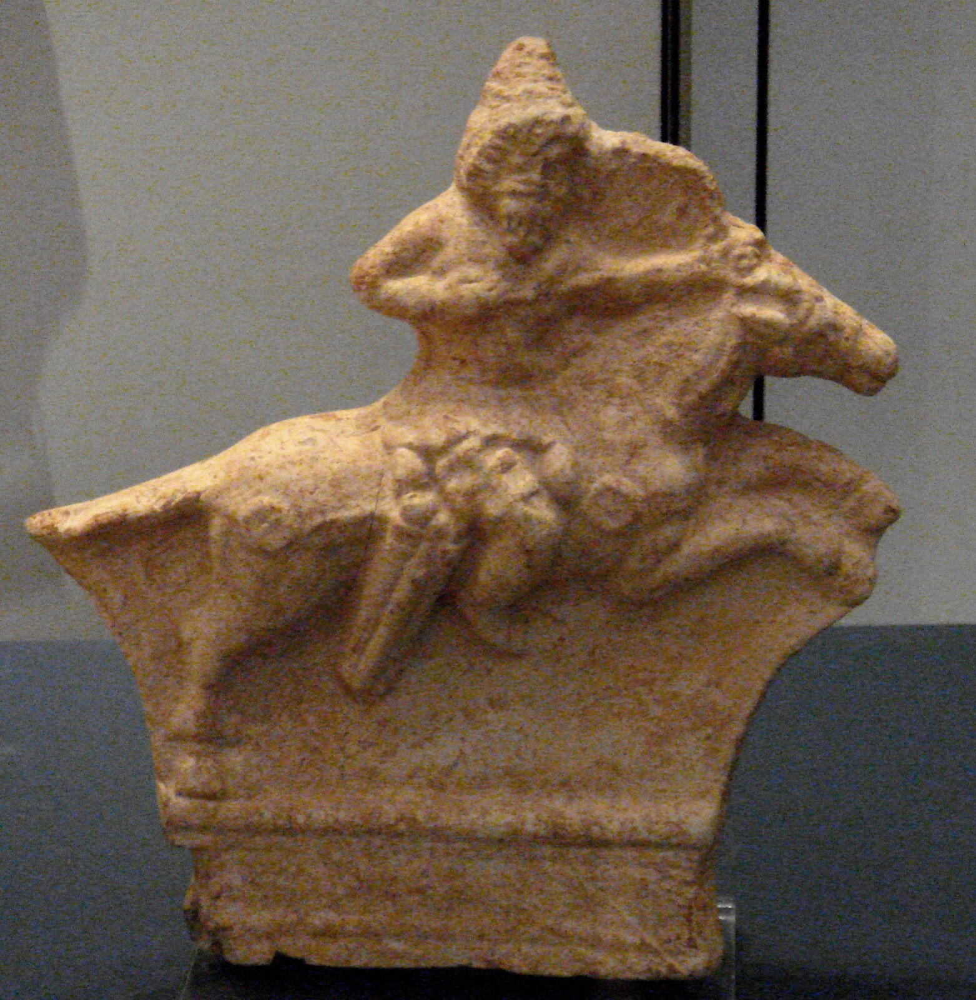

# The layered bow

| | |
|---|---|
| **First made** | About 3,500 years ago, in western Asia; the steppe took it up soon after |
| **Made of** | Wood, horn and sinew, held with glue |
| **What it does** | Stores the energy of a long bow in a short one |
| **Before it** | The bow cut from a single piece of wood |
| **After it** | The bows of the horse peoples of Asia, until the gun |

## Why it mattered

When a bow is drawn, the side that faces the target is stretched and the side that faces the archer is squeezed. Sinew can be stretched a long way and will spring back, and horn can be squeezed hard without crushing. A bow built up from all three stores far more energy for its length than a bow of plain wood, and so it can be a good deal shorter and still hit as hard.

A short bow can be swung from one side of a horse's neck to the other. In the hands of a man who has ridden since before he could remember, it made an archer who came within range, shot, and wheeled away before anyone on foot could reach him. A farming state had no cheap answer to that.

## The real thing

*A horse archer of ancient Iran, turning in the saddle to shoot, in the British Museum. Photo: PHGCOM, public domain.*
