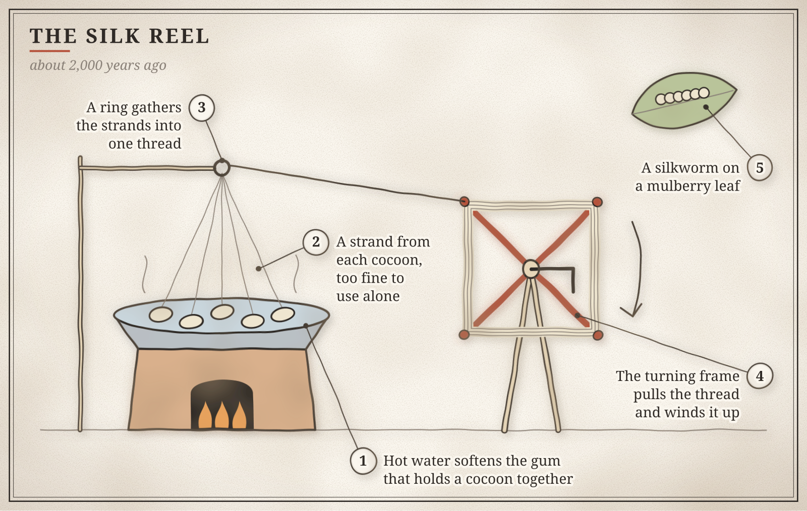
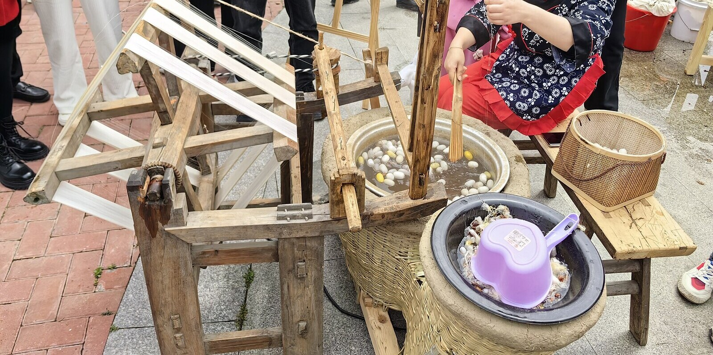

# The silk reel

| | |
|---|---|
| **First made** | In China, more than 4,000 years ago. By 2,000 years ago it was farmhouse work across the Han empire |
| **Made of** | A pan of hot water, a guide for the thread, and a wooden frame that turns |
| **What it does** | Draws the strands off several cocoons at once and winds them up as one thread |
| **Before it** | Thread spun from short fibres, such as hemp and wool |
| **After it** | The foot-powered reel, the steam-powered silk mill, and the reeling machines of today |

## Why it mattered

Almost every other thread is spun. Wool, flax and hemp come in short fibres, and the spinner twists them together so that they grip one another. Reeled silk has no short fibres in it and no loose ends, which is why the cloth is so smooth.

No reel of Han times survives, and how it was built is not known in detail. What survives is the cloth. The silks buried with nomad lords in Mongolia about 2,000 years ago are woven from long unbroken strands, which is the mark of reeling. The oldest full description of a reeling frame was written about 900 years ago.

## The real thing

*A wooden reel of the traditional pattern at work in China in 2024. The cocoons float in the pan, and the thread is wound onto the frame at the left. Photo: Uuongkinghe, CC BY-SA 4.0, cropped.*
