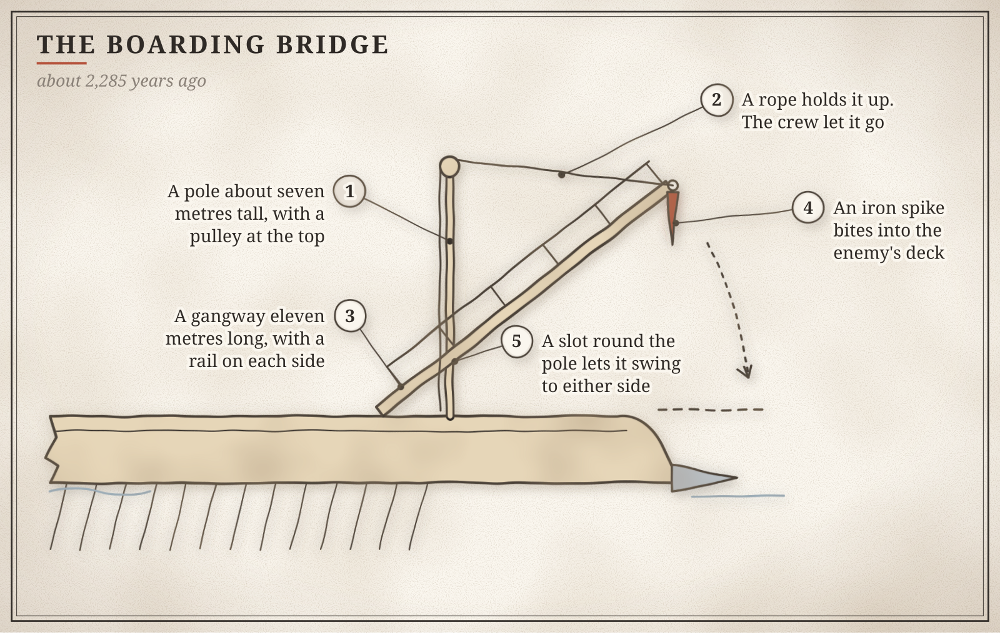
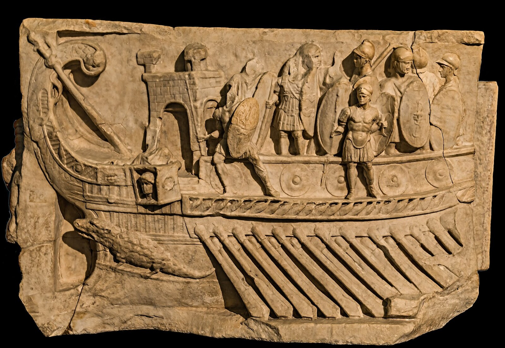

# The boarding bridge

| | |
|---|---|
| **First made** | About 2,285 years ago, by the Romans, at war with Carthage |
| **Made of** | A railed gangway, a pole, a rope and pulley, and an iron spike |
| **What it does** | Pins an enemy ship, so that soldiers can cross |
| **Before it** | The ram, and grappling irons thrown by hand |
| **After it** | The harpax, a grappling hook shot from a catapult |

## Why it mattered

A sea battle of the time was a contest of rowing. Each galley tried to turn faster than its enemy and ram him in the side, and the best crews had trained for years. The boarding bridge let the Romans refuse that contest. Once its spike was in, the faster ship could not get away.

Polybius, who calls it the raven, gives the only detailed account, and no example has been found. It drops out of his story after a few years, perhaps because its weight at the bow made a ship unsafe in rough water. By then Roman crews had learned the sea, and they won the war's last battle in light, fast ships.

## The real thing

*No boarding bridge survives. This Roman warship, packed with armoured soldiers, is from a marble relief made a little over 2,000 years ago. Vatican Museums. Photo: Rabax63, CC BY-SA 4.0.*
