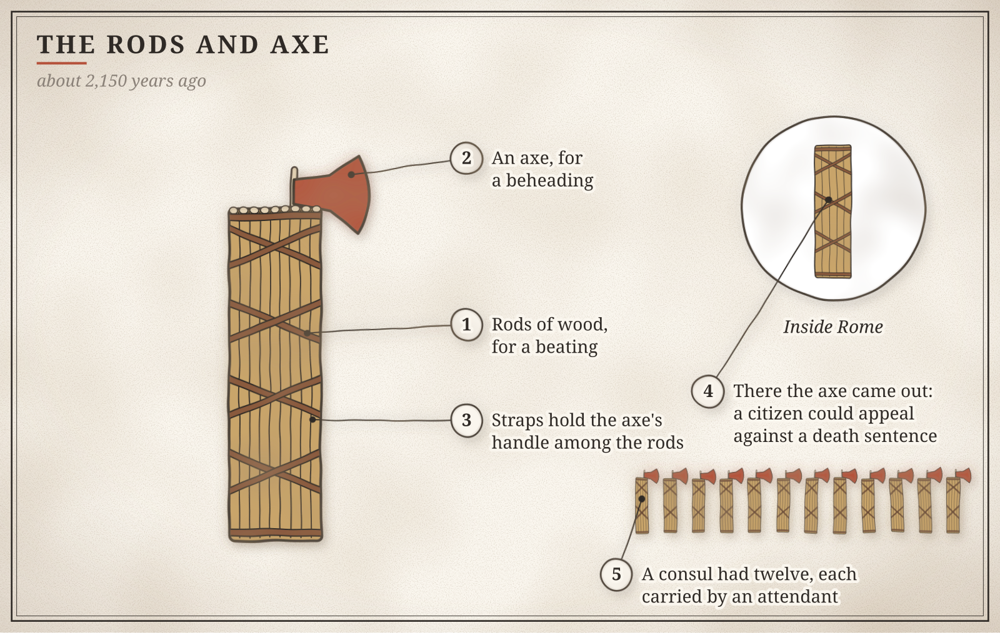
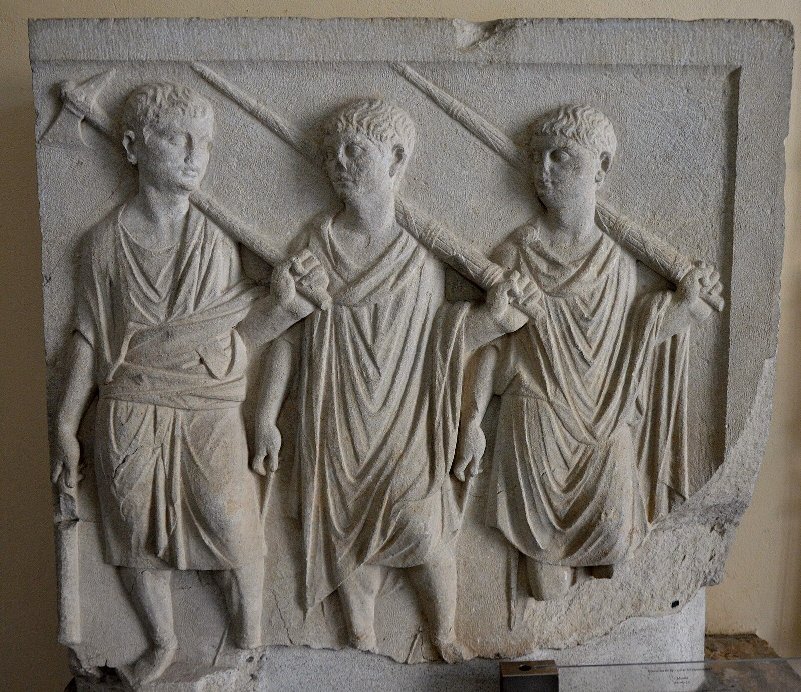

# The rods and axe

| | |
|---|---|
| **First made** | About 2,650 years ago, by the Etruscans, north of Rome |
| **Made of** | Wooden rods strapped round the handle of an axe |
| **What it does** | Shows that an official can have a man beaten or killed |
| **Before it** | The sceptre of a king |
| **After it** | Borrowed by the French Republic, the United States and Mussolini's Fascists |

## Why it mattered

In Rome, power could be seen coming down the street. A consul in public walked behind twelve attendants, each with a bundle on his shoulder, and people stood aside. The bundle was a punishment carried ready for use: the rods for a beating, the axe for a beheading.

Inside the city, the attendants took the axe out. A citizen there could appeal to the people against being put to death, and the bundle said so to everyone who saw it pass. Outside the city, above all with an army in the field, the axe went back in. When a consul addressed the people, his attendants lowered the rods before them.

## The real thing

*Attendants carrying bundles of rods, on a Roman relief from Concordia, in north-east Italy. National Museum of Concordia, Portogruaro. Photo: Following Hadrian, CC BY-SA 2.0.*
