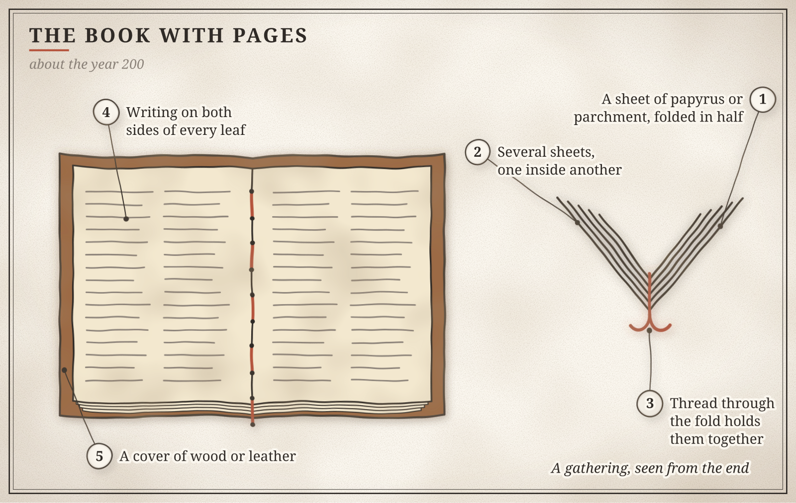
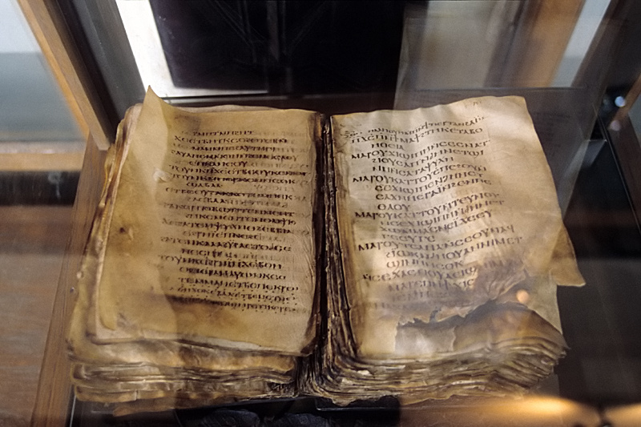

# The book with pages

| | |
|---|---|
| **First made** | In the Roman empire, by the end of the first century |
| **Made of** | Sheets of papyrus or parchment, folded and sewn at the fold |
| **What it does** | Holds a long text in a small block that opens at any page |
| **Before it** | The scroll, and notebooks of wax tablets tied together |
| **After it** | Nearly every book since, handwritten or printed |

## Why it mattered

A scroll is written on one side only, and a reader looking for a passage near the end has to wind through everything before it. A codex is written on both sides of each leaf, so it holds about twice as much, and it opens anywhere. One codex could carry all four gospels, which would have filled several scrolls.

In Roman Egypt in the first two centuries, fewer than one book of Greek literature in fifty was a codex. Of the Christian copies of the scriptures that survive from before 400, nearly all are. Historians still argue about why. By about 300 the codex had drawn level with the scroll, and two centuries later the scroll had almost gone.

## The real thing

*The Mudil Psalter, a book of psalms in Coptic from about the year 400, found in 1984 under the head of a girl buried in Egypt. Coptic Museum, Cairo. Photo: Roland Unger, CC BY-SA 3.0.*
