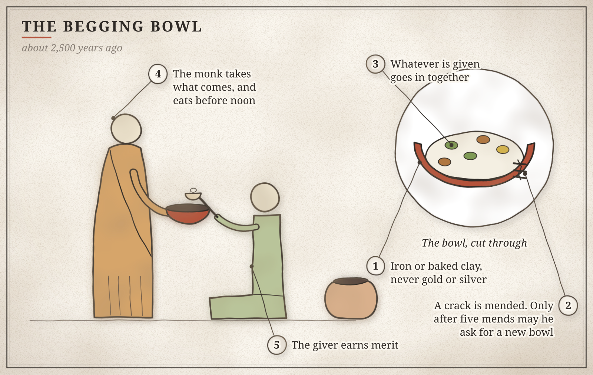
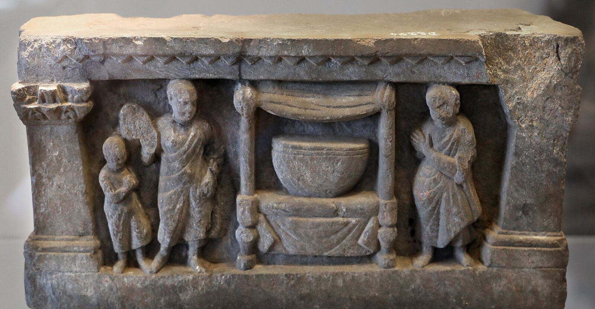

# The begging bowl

| | |
|---|---|
| **First made** | In northern India, for the Buddha's followers, about 2,500 years ago |
| **Made of** | Iron or baked clay |
| **What it does** | Carries a monk's food for the day, all of it given |
| **Before it** | The alms of India's wandering holy men |
| **After it** | The alms round that monks still walk each morning in Thailand, Myanmar and Sri Lanka |

## Why it mattered

A monk could not choose his dinner. Whatever a household put in went into the one bowl, all together, and he ate it. He could even eat meat, so long as he had no reason to think the animal had been killed for him.

The rules kept the bowl humble. It had to be of iron or baked clay, never of gold or silver. If it cracked, the monk mended it, and he might not ask for a new one until it had been mended five times. The Buddha's own bowl, however, became a relic. Faxian saw it in Peshawar, and was told that a king who tried to carry it off found that even eight elephants could not move it.

## The real thing

*The Buddha's bowl, honoured as a relic under a canopy, on a slate relief from Gandhara made about the year 300. National Museum of Denmark, Copenhagen. Photo: Francesco Bini, CC BY-SA 4.0.*
