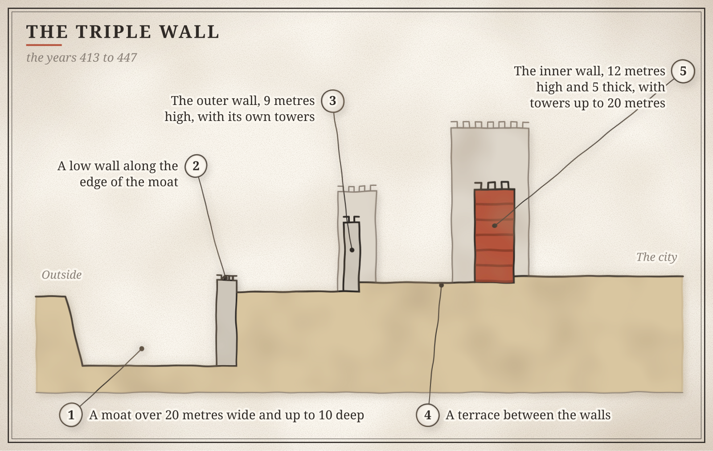
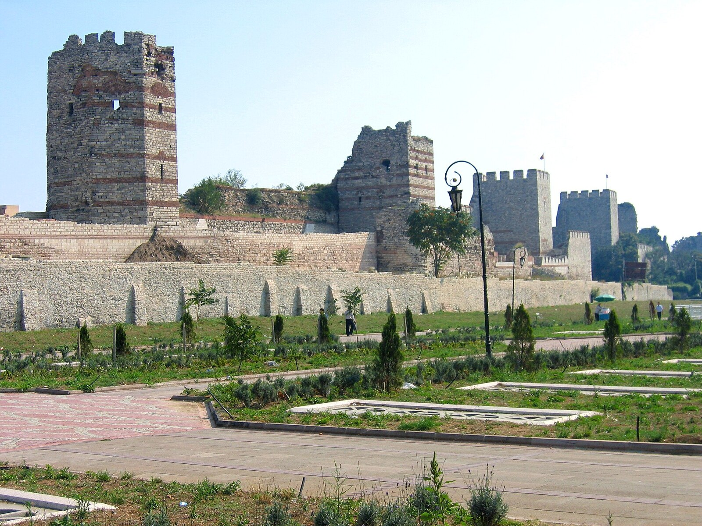

# The triple wall

| | |
|---|---|
| **First made** | The inner wall by 413; the outer wall and the moat soon after 447 |
| **Made of** | Limestone blocks with bands of red brick, over a core of mortar and rubble |
| **What it does** | Makes an attacker cross a moat and three walls, each overlooked by the one behind it |
| **Before it** | The single wall of Constantine's smaller city, further in |
| **After it** | Cannon. In 1453 the Ottoman guns battered it for weeks, and the city fell |

## Why it mattered

Each line covered the one in front of it. An enemy who climbed out of the moat stood under the low wall. If he took that, he was on an open strip below the outer wall, and if he took the outer wall, he was caught on the terrace beneath towers twenty metres high. The inner towers stood taller than the outer ones, so both lines of defenders could shoot at once.

In 447 an earthquake threw down long stretches of the wall while Attila's Huns were on the march. The circus factions of the city turned out to clear the rubble, and the wall was standing again in about two months. Over the next centuries Avars, Persians, Arabs and Bulgars all came to it, and all went away.

## The real thing

*Part of the land walls of Constantinople, now Istanbul, partly restored. The tall towers stand on the inner wall, with the lower outer defences in front. Photo: Johann H. Addicks, CC BY-SA 3.0.*
