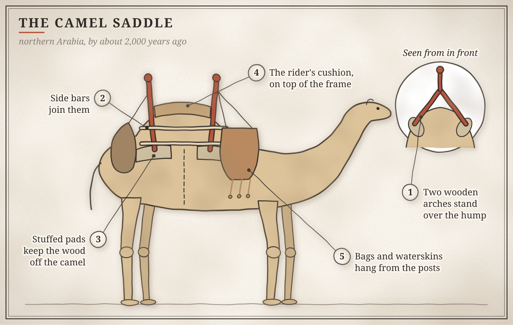
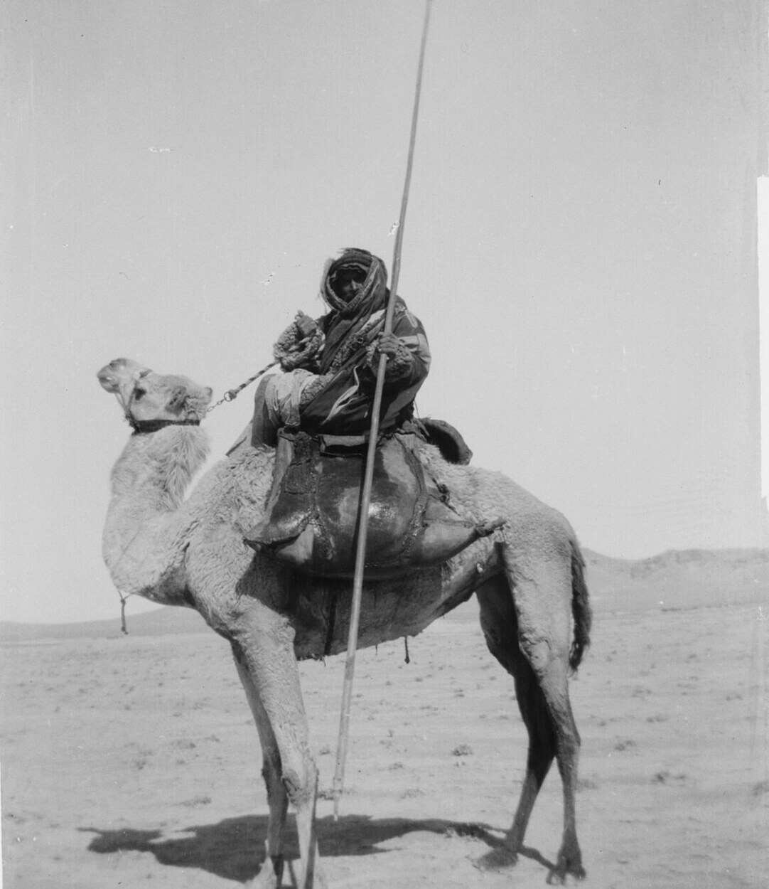

# The camel saddle

| | |
|---|---|
| **First made** | In northern Arabia, by about 2,000 years ago |
| **Made of** | A frame of tamarisk wood, pads stuffed with straw or palm fibre, rope and leather |
| **What it does** | Seats the rider on top of the hump, with his water and baggage hung around him |
| **Before it** | Riding behind the hump, bareback or perched on a pack saddle |
| **After it** | Little changed. Most of Arabia still rode on it in the 1900s |

## Why it mattered

A hump is a mound of fat, a poor base for a seat or a load. This saddle stands over it like a bridge, so that the weight rests on pads in front of it and behind it. On top sits the rider, often well forward, with his legs crossed round the front post, and everything he needs for a long journey hangs from the frame.

Some historians once thought it turned the camel into a war horse and made the nomads masters of the caravan roads. People who lived among the Bedouin saw it differently: men rode to a raid on camels and got down, or changed to a horse, to fight. The saddle's gift was distance. A rider and his supplies crossed the desert together on one animal.

## The real thing

*A Bedouin spearman with full waterskins, about 1900. Photo: Matson Collection, Library of Congress, public domain.*
