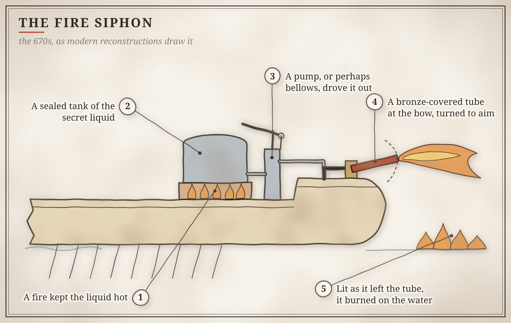
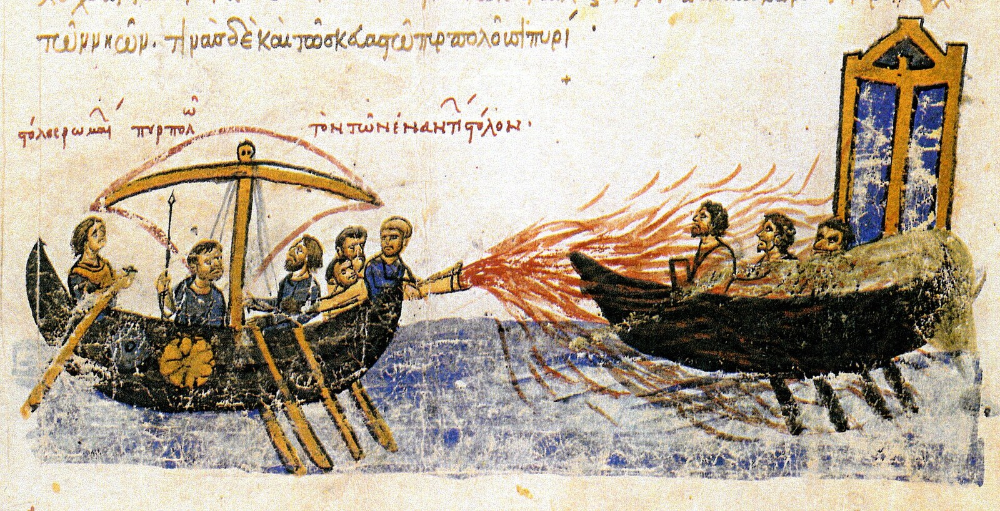

# The fire siphon

| | |
|---|---|
| **First made** | About 672, in Constantinople. It is credited to Kallinikos, an architect who had fled from Syria |
| **Made of** | A heated metal tank, a pump, a bronze-covered tube, and a liquid whose recipe is lost |
| **What it does** | Throws a jet of burning liquid at an enemy ship, and the fire goes on burning on the sea |
| **Before it** | Pots of pitch, sulphur and naphtha, set alight and thrown by hand or by machine |
| **After it** | A hand-held siphon, and pots of the liquid thrown like grenades. Later the recipe was lost |

## Why it mattered

Wooden ships, caulked with pitch and hung with rope, burn easily. Earlier fire weapons, however, had to be thrown, in pots or on arrows. The siphon aimed a stream of fire like a hose, and what fell into the sea kept burning. In a modern trial, a working reconstruction threw its jet about fifteen metres.

Much about it is not known. The recipe was a state secret, and an emperor of the 900s told his son never to give it to any foreign people. Most historians think it was based on crude oil. However, no surviving text says how the liquid was mixed, how the pump was built, or how the jet was lit.

## The real thing

*A fleet of Constantinople burns a rebel's ship in the 820s, painted in a manuscript of the 1100s, long after the event. Madrid, National Library of Spain. Image: public domain.*
