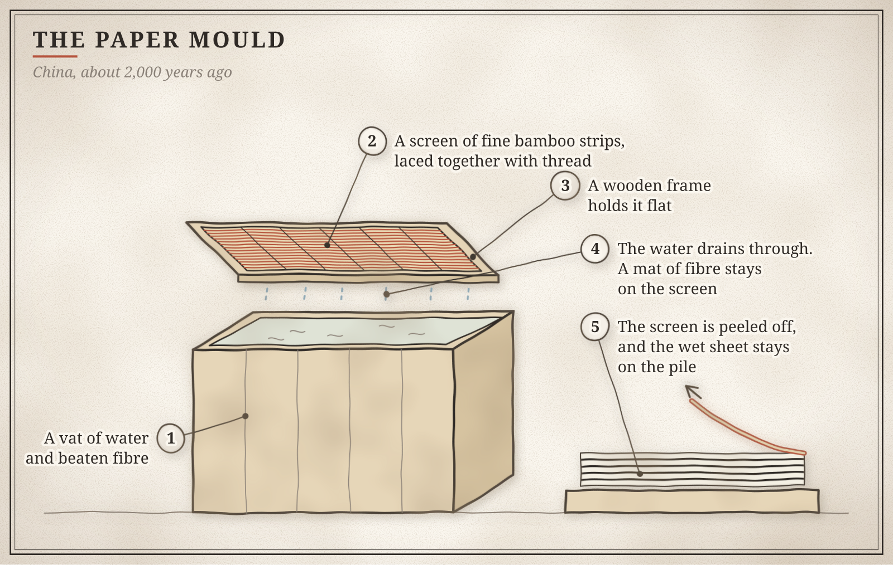
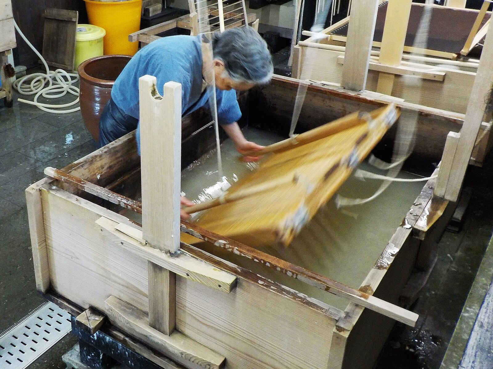

# The paper mould

| | |
|---|---|
| **First made** | In China, about 2,000 years ago |
| **Made of** | A screen of thin bamboo strips laced with thread, held flat in a wooden frame |
| **What it does** | Lifts a thin, even layer of fibre out of a vat, which dries into a sheet of paper |
| **Before it** | Bamboo strips and silk in China; papyrus and parchment in the West |
| **After it** | Wire moulds in Europe, with watermarks from 1282. A paper machine in 1799 |

## Why it mattered

Each dip makes one sheet. The papermaker dips it, lifts it out level and shakes it gently so that the fibres settle evenly. The water runs away, and the screen is laid face down on the pile and peeled off, leaving the wet sheet behind. The same mould then goes straight back into the vat, and a skilled worker repeats the movement all day.

The screen also leaves its mark. Held up to the light, a handmade sheet shows faint lines where the strips and threads lay. Papermakers in Italy later bent wire into letters and pictures and sewed them onto their moulds, and the shapes show in the paper as watermarks. Historians still use them to date old documents.

## The real thing

*A papermaker dips a mould into the vat at Echizen, Japan. Photo: TR15336300101, CC BY-SA 4.0.*
