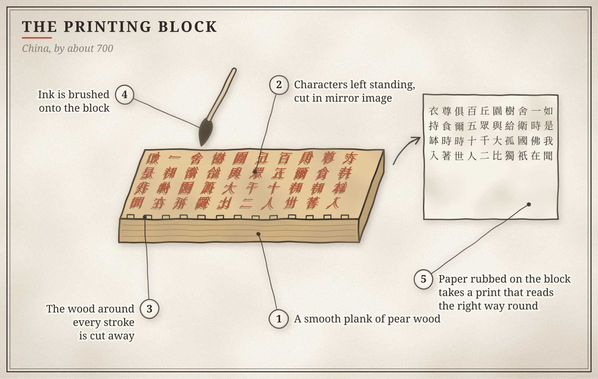
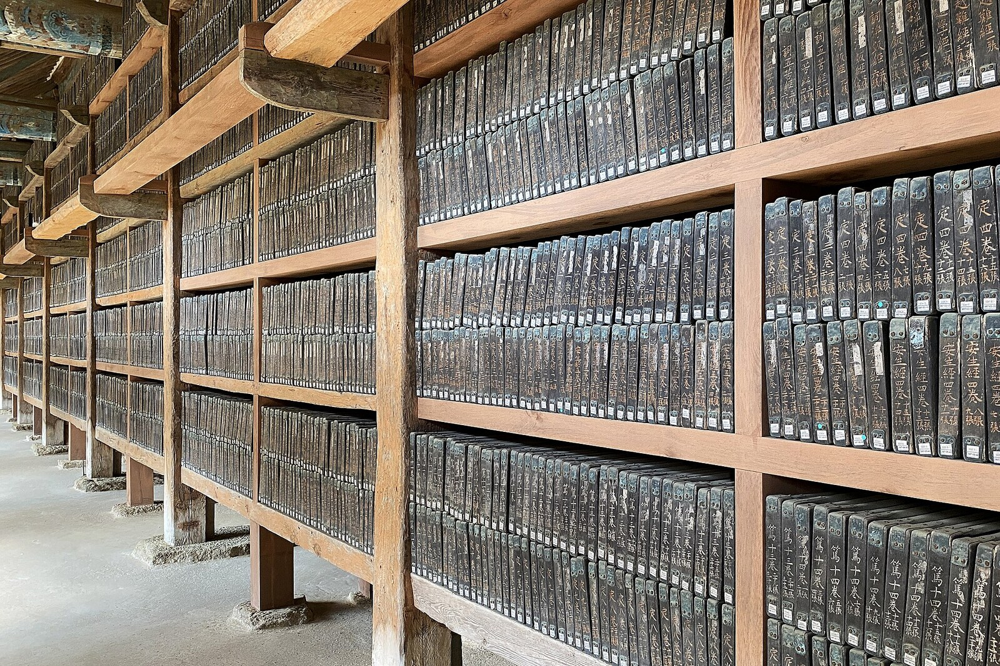

# The printing block

| | |
|---|---|
| **First made** | In China, by about 700 |
| **Made of** | A plank of close-grained wood such as pear, carved on one face or on both |
| **What it does** | Prints a whole page, text and pictures together, at every pull |
| **Before it** | Seals stamped in ink, and rubbings taken from inscriptions cut in stone |
| **After it** | Movable type. Yet blocks printed most Chinese books until the late 1800s |

## Why it mattered

The slow part was the carving. A skilled carver cut perhaps 150 characters in a day, so a long book kept a team busy for months or years. Printing, by contrast, was quick and cheap, and a finished block could be printed from again and again.

In Korea, starting in 1237, monks and craftsmen carved the entire Buddhist canon, more than 52 million characters on about 81,000 blocks, as a prayer for help against the invading Mongols. It took about twelve years. The blocks are still kept at the mountain temple of Haeinsa, in halls built so that air moves freely through the racks.

## The real thing

*Some of the 81,000 blocks of the Korean Buddhist canon, carved in the 1200s, on their racks at Haeinsa. Photo: Bernard Gagnon, CC0.*
