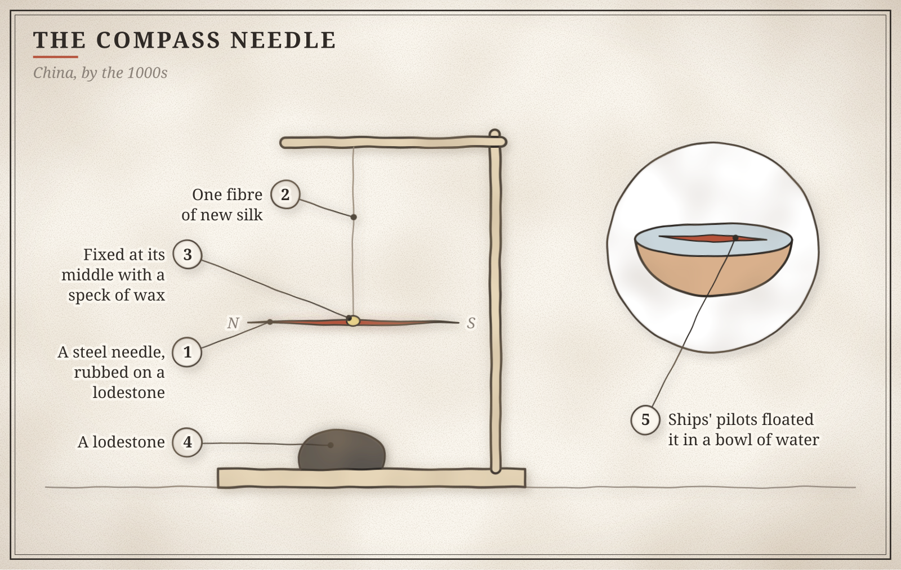
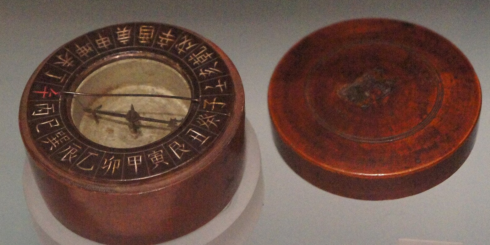

# The compass needle

| | |
|---|---|
| **First made** | In China, by the 1000s |
| **Made of** | A steel needle rubbed on a lodestone, hung from a silk fibre or floated on water |
| **What it does** | Swings until it lies north and south, by day or night and under any sky |
| **Before it** | The diviners' spoon of lodestone, spun on a bronze plate |
| **After it** | A dry needle turning on a pivot, described in Europe in 1269, and later a card of directions turning with it |

## Why it mattered

A needle could also be made without a lodestone. A military handbook of 1044 tells how to cut a thin leaf of iron into the shape of a fish, heat it red-hot, and plunge it into water with its tail pointing north. Floated in a bowl, the fish turned its head to the south. Iron that cools lying in line with the earth's magnetism keeps a little of it, and the trick works.

By 1190 Europe knew the needle too. An English scholar of that time described sailors who touched a needle to a magnet and watched where it pointed, so that they could find north when cloud hid the sun and the stars.

## The real thing

*A Chinese mariner's compass of about 1760, with a needle on a pivot inside a ring of 24 directions. National Maritime Museum, Greenwich. Photo: Victoria C, CC BY-SA 4.0, cropped.*
