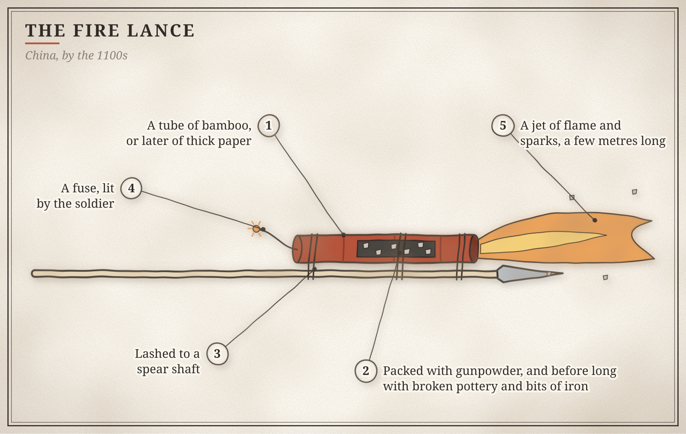
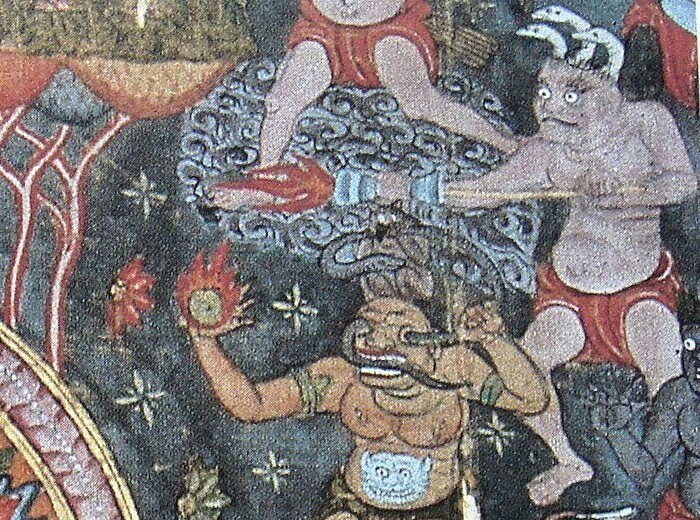

# The fire lance

| | |
|---|---|
| **First made** | In China. A painting of about 950 shows one; it was in battle by 1132 |
| **Made of** | A tube of bamboo or thick paper, packed with gunpowder and lashed to a spear |
| **What it does** | Throws a jet of flame, and later shards of pottery and iron, about three metres |
| **Before it** | Gunpowder as an incendiary, packed into balls and tied to arrows |
| **After it** | Tubes of metal, fired without the spear. The oldest dated gun was cast in 1298 |

## Why it mattered

A fire lance worked once. The soldier lit the fuse, pointed the tube, and for a short while it roared out flame. After that he held an ordinary spear. Against men coming over a wall or through a breach, a jet of fire in the face was often enough. In 1233 a Jin officer led 450 men armed with fire lances of paper in a night attack on a Mongol camp. The official history of the Jin says 3,500 Mongols drowned as they fled.

The weapon also lasted. It reached the Middle East by about 1280 and Europe later, and English warships were still being issued with fire lances in 1660, long after guns had grown out of them.

## The real thing

*A demon aims a tube spouting flame at the Buddha, in a silk painting from Dunhuang of about 950. Image: public domain, cropped.*
