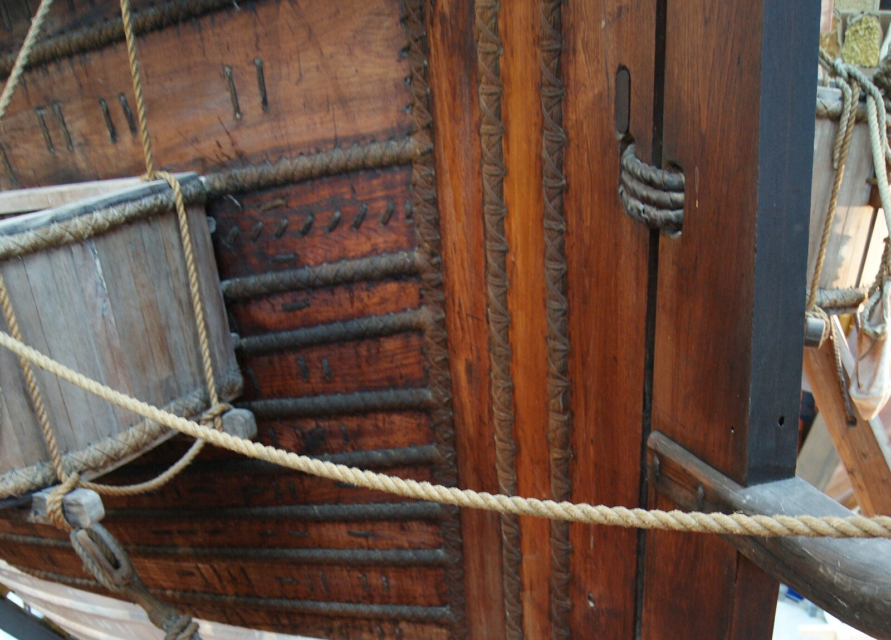

# The sewn ship

| | |
|---|---|
| **First made** | On the coasts of Arabia, India and East Africa, by the first century |
| **Made of** | Hardwood planks, coconut-fibre cord and rolls of fibre, sealed with putty |
| **What it does** | Holds the planks of a hull together without a single nail |
| **Before it** | Dugout canoes, and hulls tied together with rope |
| **After it** | Nailed hulls, after Portuguese ships arrived in 1498 |

## Why it mattered

Sewing a ship took patience. The builders of the Jewel of Muscat, a copy of the Belitung ship, drilled more than 37,000 holes and used over 120 kilometres of coconut cord. Workers sewed in pairs, one inside the hull and one outside, hammering each stitch tight over the fibre roll. Every hole was then plugged and sealed.

The result was a hull that gave a little instead of splitting when it struck a reef. Marco Polo thought such ships flimsy, and said that many were lost. Even so, they carried the ocean's trade for well over a thousand years, and one port in East Africa was named Rhapta, from the Greek word for "sewn".

## The real thing

*The stern of the Jewel of Muscat, a sewn ship built in Oman. Photo: Jacklee, CC BY-SA 3.0, cropped.*
