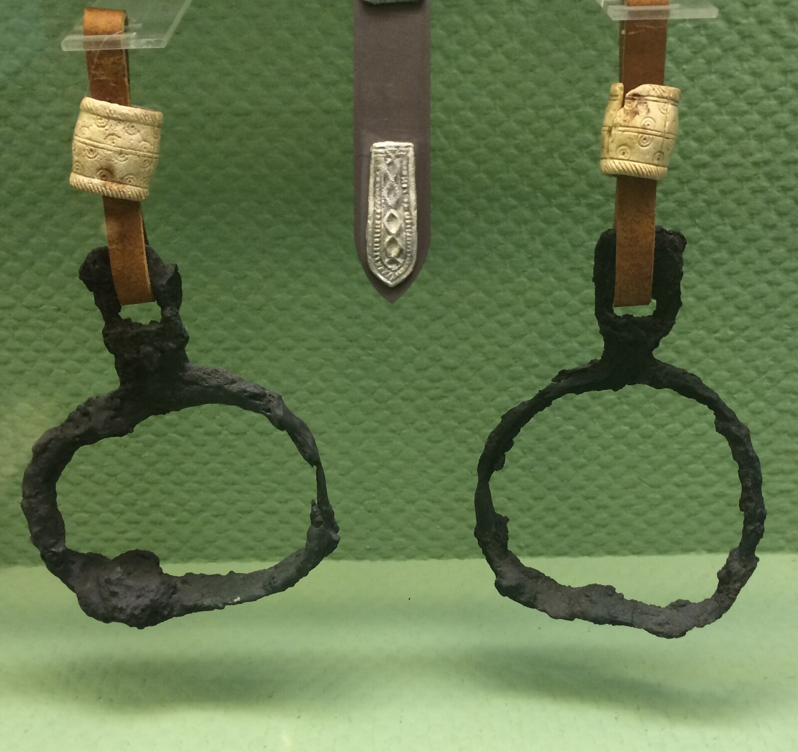

# The stirrup

| | |
|---|---|
| **First made** | In Asia. China had pairs of them by the early 400s |
| **Made of** | Iron, hung from the saddle on a leather strap |
| **What it does** | Holds the rider's feet, so he can stand, lean and strike without falling |
| **Before it** | Riders gripped with their knees, or sat between the horns of a Roman saddle |
| **After it** | Brought to Europe by the Avars about 600. Little changed since |

## Why it mattered

Horse archers of the steppe fought well without stirrups. The stirrup added steadiness. With his feet in them, a rider could rise in the saddle, lean far out to swing a sword, and stay on when he hit something hard. Together with a saddle high behind and in front, they let a knight clamp his lance under his arm and strike with the weight of the charging horse. That way of fighting spread in the 1000s.

A famous book of 1962 argued that the stirrup created the knight, and with him the whole order of lords and vassals. Historians have dropped it. Stirrups spread slowly: of 704 men's graves of the 700s dug up in Germany, only 13 held them.

## The real thing

*Iron stirrups of the Avars, from Hungary, 600s or 700s. Photo: Bjoertvedt, CC BY-SA 4.0.*
