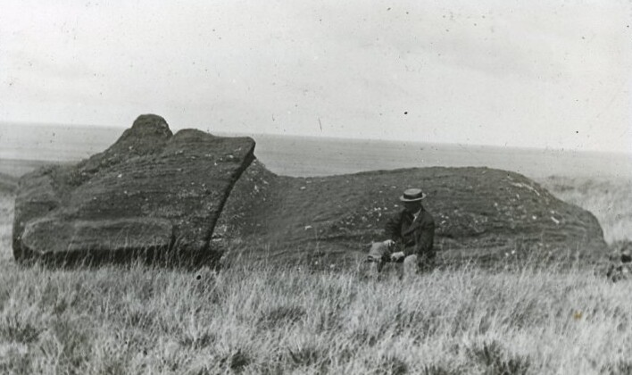

# The walking statue

| | |
|---|---|
| **First made** | On Rapa Nui, mostly between about 1250 and 1500 |
| **Made of** | Volcanic tuff, three ropes and a team of about twenty |
| **What it does** | Rocks a standing statue forward, one corner at a time |
| **Before it** | Dragging, the way heavy stones were moved almost everywhere |
| **After it** | Base trimmed flat on arrival. Tried again in 1986 and 2012 |

## Why it mattered

The shape does most of the work. A road statue leans forward by up to about 15 degrees, so that its weight sits over the front of a broad base shaped like a D. A tug from one side tips it onto a corner, and the lean carries the lifted side forward. The hard part is starting the rocking. Once the statue is swaying, the pullers can work with one arm.

Other teams have tried it. In 1986 a Czech engineer and sixteen islanders moved a real statue with ropes at its head and base, but the trial was stopped when chips broke off the base. The concrete copy of 2012 covered 100 metres in about 40 minutes.

## The real thing

*A statue lying beside the old road from the quarry, photographed by the Mana Expedition in 1914 or 1915, with a man for scale. Public domain.*
