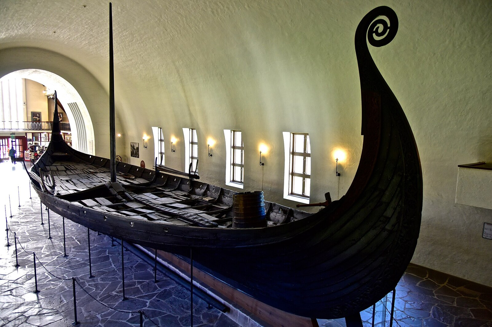

# The longship

| | |
|---|---|
| **First made** | In Scandinavia, once keel and sail were added in the 700s |
| **Made of** | Split oak, iron rivets, tarred wool and a woollen sail |
| **What it does** | Crosses open sea under sail and rows up shallow rivers |
| **Before it** | Rowing boats with no sail, like the Nydam boat of about 320 |
| **After it** | The broad knarr for cargo, then the cog of the Baltic towns |

## Why it mattered

The ship was steered by one large oar, hung near the stern on the right-hand side. Sailors called that side the steering board, and English still calls it starboard. The rowers worked through holes in the top plank. On the Gokstad ship each hole could be closed when the sail was up.

Every overlap was packed with wool or animal hair soaked in tar. Then an iron nail was driven through both planks from outside and hammered over a small square plate on the inside. The Gokstad ship's lowest nine planks on each side were not riveted to its ribs at all. They were tied to them, an older method that its builders kept.

## The real thing

*The Oseberg ship, buried in a mound in Norway in 834, photographed in the Viking Ship Museum in Oslo. Photo: Larry Lamsa, CC BY 2.0.*
