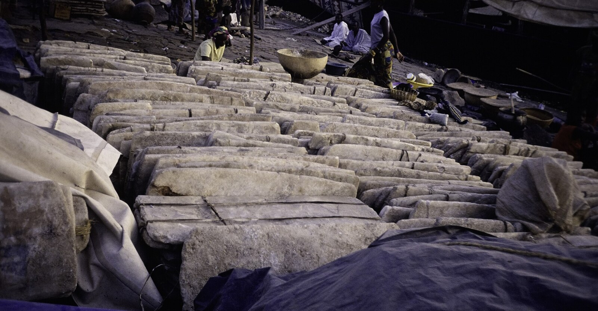

# The salt slab

| | |
|---|---|
| **First made** | At mines in the western Sahara. A geographer describes one, twenty days south of Morocco, in 1068 |
| **Made of** | Rock salt, from the bed of a lake that dried up thousands of years ago |
| **What it does** | Puts salt in a shape that a camel can carry across the desert, and that breaks into pieces for sale |
| **Before it** | Salt boiled from seawater on the coast, and weak salt from the ashes of burned plants |
| **After it** | Taoudenni took over from Taghaza in the late 1500s. Its slabs still go south, though trucks now carry many of them |

## Why it mattered

At Taoudenni, the mine that replaced Taghaza, miners dig square pits about four metres deep. They throw out the red clay, cut through layers of poor salt, and reach the good salt beneath, which lies in flat beds. With axes they split it into slabs about a metre long and five centimetres thick, each weighing about 30 kilograms.

In the south the slab did the work of money. Ibn Battuta wrote that in Mali salt was used as gold and silver were used elsewhere: people cut it into pieces and paid with it. A slab carried whole across the desert could be broken into small change at the market.

## The real thing

*Slabs of rock salt standing in rows at the river port of Mopti, Mali, in 1993. Some are tied together with cord. Photo: Angeline A. van Achterberg, CC BY-SA 4.0.*
