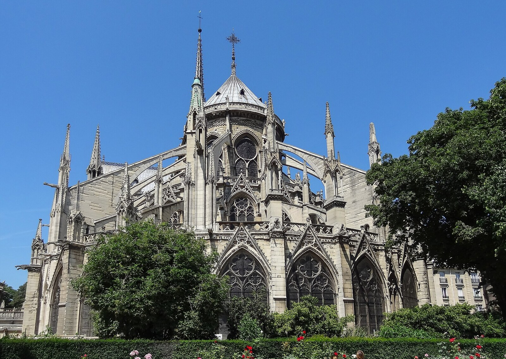

# The flying buttress

| | |
|---|---|
| **First made** | Around Paris, from about 1160. Notre-Dame had them by 1180 |
| **Made of** | Cut stone: a sloping arch, a tall pier and a pinnacle |
| **What it does** | Carries the vault's sideways push out over the aisle roof |
| **Before it** | Thick walls, and arches hidden under the aisle roofs |
| **After it** | Dropped in the Renaissance. Used on lighthouses in the 1900s |

## Why it mattered

A tall church is pushed sideways in two ways. The stone vault presses outwards all the time, and the wind leans on the steep timber roof above it. Builders often set two arms, one above the other. The lower one met the push of the vault, and the upper one braced the walls against the wind.

The pinnacle on top of each outer pier was not only decoration. Its weight pressed down on the pier and helped turn the sideways push towards the ground. The early arms, like those at Chartres, were heavier than they needed to be. Later builders, at Amiens and Le Mans, made them much slimmer.

## The real thing

*The flying buttresses around the east end of Notre-Dame in Paris, photographed in 2013. Photo: Eutouring, CC BY-SA 4.0.*
