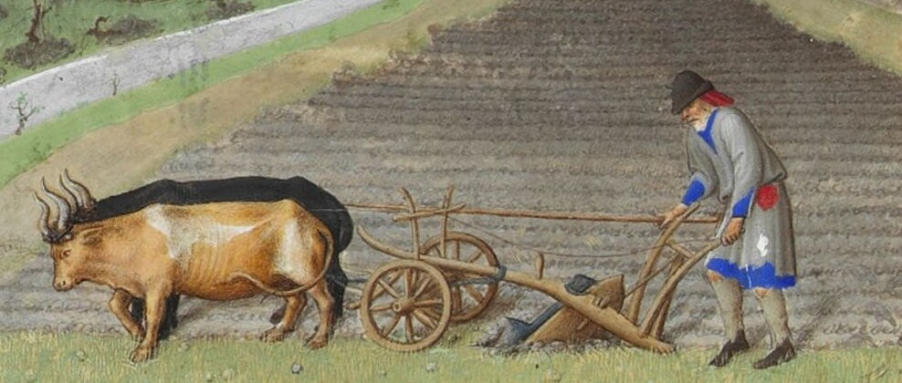

# The heavy plough

| | |
|---|---|
| **First made** | In the Roman north-west by the 300s. Widespread after 800 |
| **Made of** | A wooden frame and board, with an iron knife and share |
| **What it does** | Cuts a slab of heavy soil and turns it upside down |
| **Before it** | The ard, which scratched the soil without turning it |
| **After it** | The lighter Rotherham plough of 1730, then ploughs of steel |

## Why it mattered

The curved board throws the slab to one side only, usually the right. So the ploughman worked round a long strip, up one side and back down the other, and every pass pushed a little soil towards the middle. Over generations each strip rose into a ridge, with a furrow on either side that drained the wet clay.

Where those fields later went to pasture, the ridges survive. They stand up to about 60 centimetres high today, and in places they were once taller than a man. Seen from the air, parts of the English Midlands are still ribbed like corduroy.

## The real thing

*Ploughing with a wheeled plough and two oxen, from the March page of the Très Riches Heures, painted in France in the 1400s. Public domain.*
