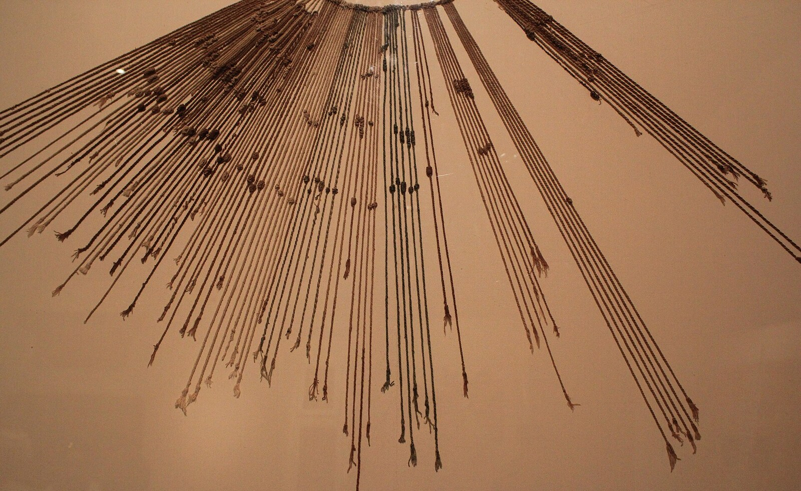

# The knotted cord

| | |
|---|---|
| **First made** | In the Andes. The oldest surviving ones are from the Wari empire, about 600 to 1000 |
| **Made of** | Cotton, or llama and alpaca wool, spun and dyed |
| **What it does** | Keeps numbers as knots, in tens, so that accounts need no writing |
| **Before it** | Thousands of years of Andean spinning and dyeing. Cord was the material people knew best |
| **After it** | Replaced by writing after the Spanish conquest |

## Why it mattered

A khipu was made and read by a trained official, the khipukamayuq, or "khipu specialist". A large one could hold hundreds of cords, and many of them checked themselves. One cord often carried the total of a group of others, and some carried totals of totals, so that a slip in the tying showed up when the sums failed to agree.

The records were also easy to change. In 1533 one of the Spanish conquerors watched keepers untie knots in one part of a khipu and tie them again in another. Fifty years later the church in Peru judged the cords idolatrous and had many of them burned.

## The real thing

*Part of a khipu in the Larco Museum, Lima, Peru. Photo: Laslovarga, CC BY-SA 4.0, cropped.*
