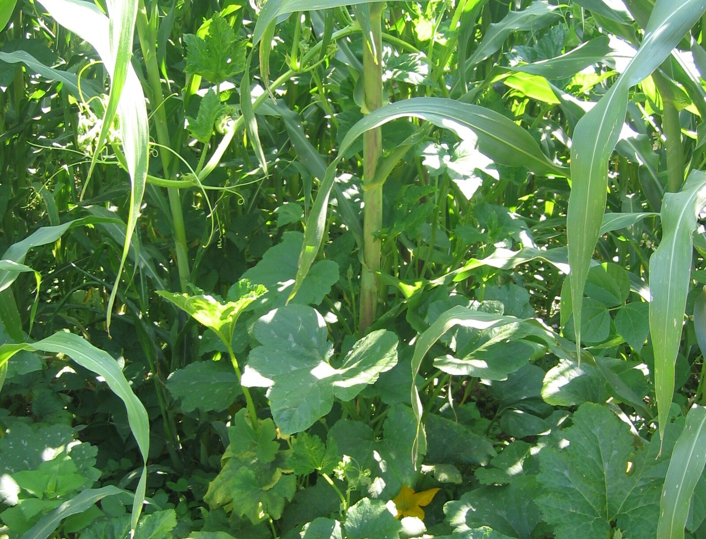

# The three sisters

| | |
|---|---|
| **First made** | In Mexico, where all three crops were tamed. In the north-east of America from about 1300 |
| **Made of** | A low mound of earth, maize and beans in the top, squash between |
| **What it does** | Grows three crops on one patch, each helping the others |
| **Before it** | Each plant tamed on its own, over thousands of years |
| **After it** | Still planted, in the milpas of Mexico and in Native American gardens |

## Why it mattered

Each mound stood about thirty centimetres high and half a metre across. The raised earth warmed sooner in spring and drained well, which suited the maize. The beans paid their way below the ground. Small swellings on their roots hold bacteria that take nitrogen from the air and turn it into plant food.

A trial in New York, planted in the Haudenosaunee way, measured the result. A field of three sisters gave more food energy and more protein than the same land sown with any one of the crops. The maize did as well as it did alone. The beans and squash yielded less, but they came on top.

## The real thing

*Maize, beans and squash together in a milpa in the Mixtepec region of Mexico. Photo: Isabelle Fragniere, CC BY-SA 3.0, cropped.*
